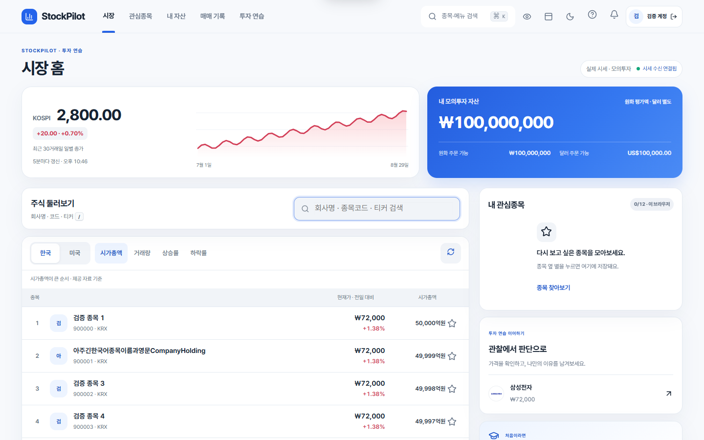
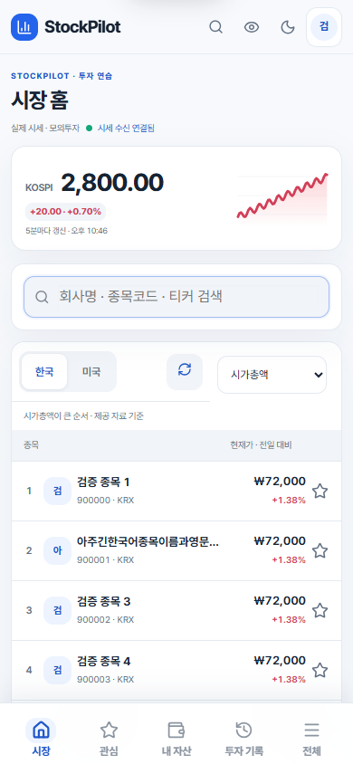
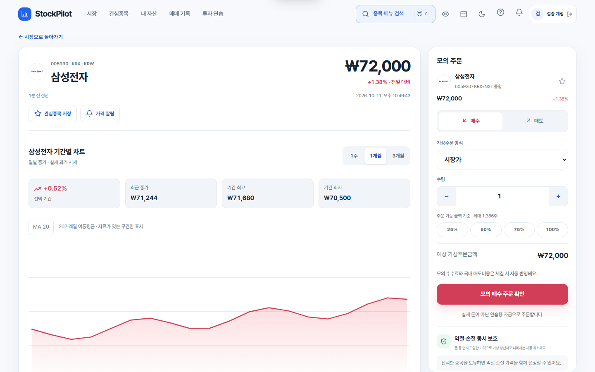
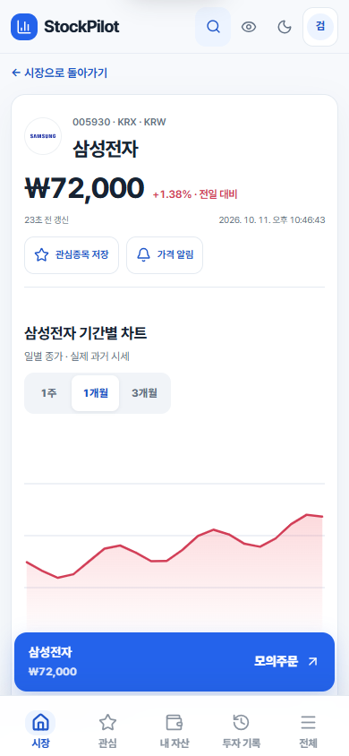
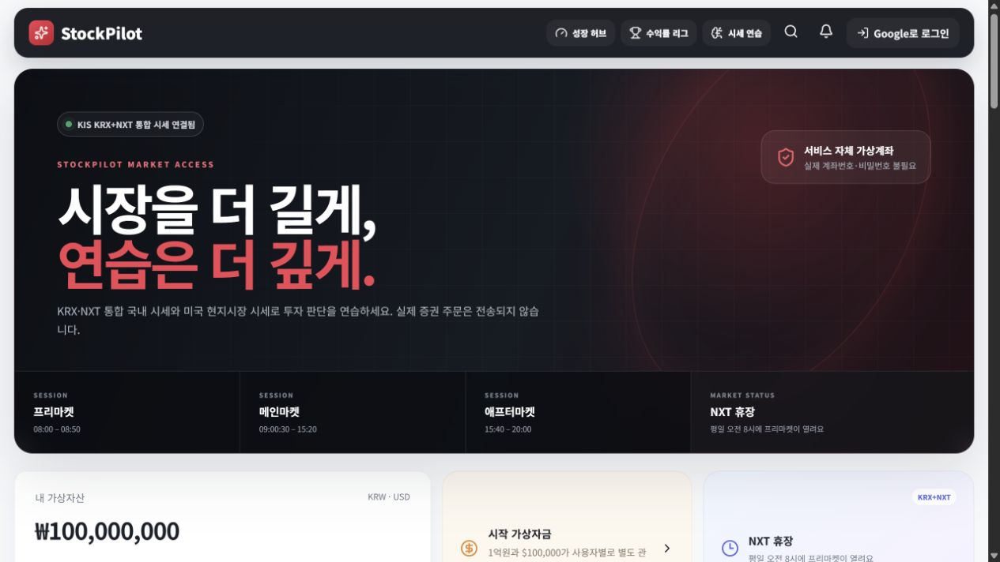
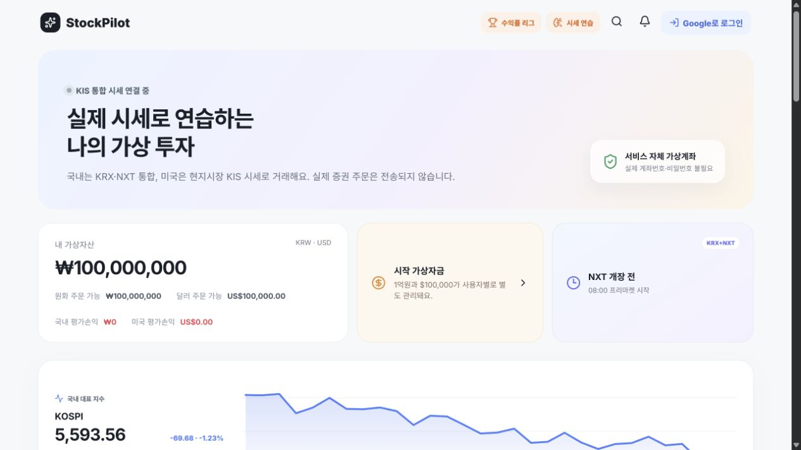
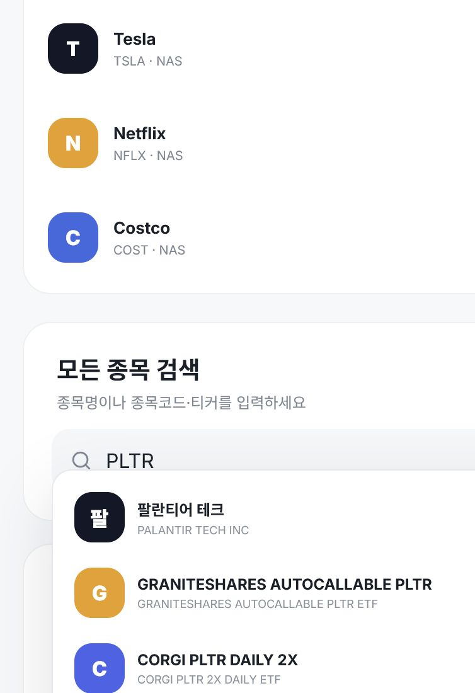
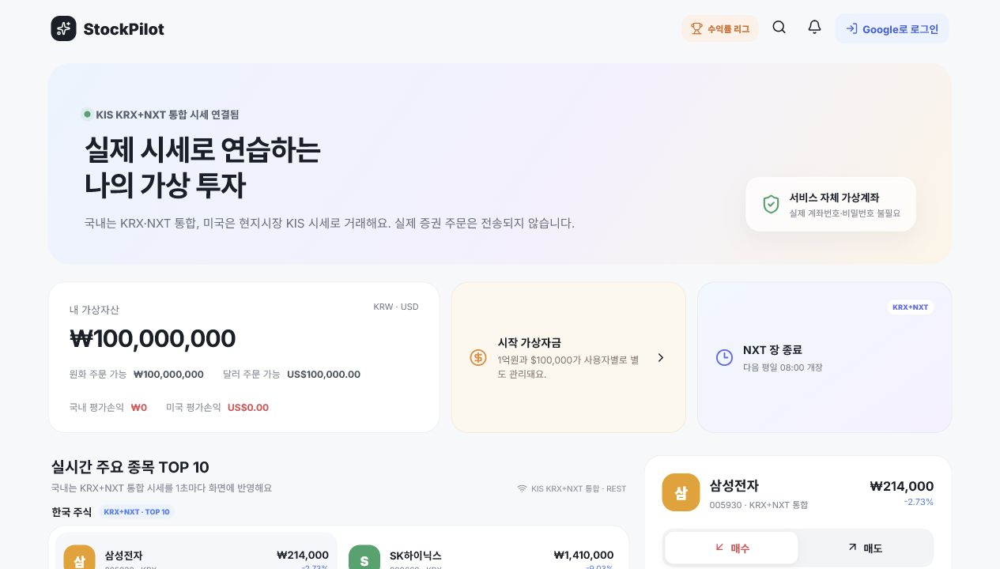

<div align="center">


# StockPilot

## 워커 관측·격리 성능 시험 준비 (2026-10-28)

- 운영자 전용 `/operations/workers`에서 최근 워커 응답과 **가격 알림·보호주문·정기매수 점검**의 성공 시각·소요 시간·실패/지연 상태를 구분합니다. 서버 Google 계정 허용 목록을 그대로 사용하며 개인 계좌·예외 원문은 제공하지 않습니다. 관측 저장 실패가 기존 작업을 막지 않도록 분리했습니다.
- `GET /api/operations/workers`는 `no-store`이며, 워커 `/` 탐침은 가벼운 생존 응답을 제공합니다. 생존·DB 준비·점검 성공·실제 체결/푸시 수신은 서로 다른 상태입니다. 여러 워커 전체의 인스턴스 수나 KIS WebSocket 복구 완료를 보증하지 않습니다.
- 미국 공시 목록은 기존 공급 범위인 최대 8건을 표시하고 중복 서식명은 읽기 쉬운 한국어와 함께 표시합니다. 공시 행·날짜·원문 접근은 기존 색상과 라이트/다크 모드를 유지하며 모바일에서 재배치합니다.
- `compose.capacity.yaml`은 **운영과 분리된 PostgreSQL·Redis·API·워커 + k6**의 첫 단계 시험 구성입니다. 운영 자격증명·외부 시세 API를 차단하며 실제 금융 거래 처리량과 구분합니다. 현재 PC에는 Docker 실행 환경이 없어 컨테이너 기동·부하 수치는 아직 미검증입니다.

실행 방법, 준비할 서버와 비용·목표·관측 기준은 [워커·성능 시험 가이드](docs/worker-capacity-20261028.md)에 있습니다. 백엔드 회귀 261개·프론트 안전성 15종·타입/빌드를 로컬에서 검증했습니다. 코드 검증과 운영 배포 완료·대규모 부하 통과는 별개입니다. 기존 계좌·주문 금액 계산·앱인토스 번들은 유지합니다.

## 미국 공시·격리 부하 검증 (2026-10-27)

- 미국 기업정보는 **SEC EDGAR의 실제 제출 이력**을 사용합니다. 별도 API 키 없이 서버의 `SEC_USER_AGENT`에 운영자 식별·연락처를 설정합니다. 연락처 원문은 저장소·브라우저에 넣지 않습니다.
- 공시는 기업 CIK 기준 공유 캐시(15분), 종목 목록 캐시(24시간), 동일 조회 합치기, 전체 API replica 간 요청 간격 제한(기본 2회/초)을 사용합니다. Redis가 설정됐지만 사용할 수 없으면 각 서버가 제각각 외부 요청을 보내지 않습니다. 403·429와 `Retry-After`를 존중하고 실패·미설정 결과는 공개 캐시하지 않습니다.
- 미국 종류주 `BRK/B`·`BRK.B`는 **SEC 목록에 실제 존재하는 `BRK-B`**로 기업 식별만 해석합니다. 화면·시세·주문의 원본 종목 식별자는 보존합니다. 잘못된 CIK·제출일·원문 경로는 출력하지 않으며 정정 제출(`/A`)도 포함합니다.
- `load_capacity.py`는 운영 도메인을 차단하고 격리 대상 확인 후 읽기 요청만 보냅니다. 단계별 목표/실제 RPS, p50/p95/p99, 실패율, 생성기 누락을 따로 기록하며 무한 대기열·자동 재시도·외부 시세 API 부하를 만들지 않습니다. 기존 `load_smoke.py`도 이 안전 실행기로 연결합니다.
- **실행 결과와 한계:** 로컬 합성 공시 읽기 시험에서 25·50 RPS 단계는 통과했으나, 100 RPS 단계는 생성기가 목표 요청량을 달성하지 못해 중단했습니다. PostgreSQL·Redis·실제 주문·WebSocket·실사용자 4만 명 수용량은 검증되지 않았습니다. 실제 공시 3개 기업의 로컬 조회와 운영 배포 여부도 구분합니다.

명령·수치·후속 시험 조건은 [SEC·부하 검증 기록](docs/sec-load-verification-20261027.md)에 있습니다. 기존 웹 디자인·계좌·주문 계산·앱인토스 번들은 변경하지 않습니다.

## 국내·미국 전체 종목 탐색

- **시장 상단의 `전체 종목`**에서 한국 **코스피·코스닥**, 미국 **나스닥·뉴욕·아멕스**의 제공 종목을 바로 검색합니다. 시가총액·거래량·상승률·하락률과 같은 패널 안에서 전환하며 별도 페이지나 아래 접힌 목록으로 이동하지 않습니다. 회사명·영문명·코드·티커 검색은 현재 보이는 20개가 아닌 선택한 시장의 전체 목록을 대상으로 합니다. 순위 API의 상위 종목과 전체 목록의 데이터 범위는 구분합니다.
- 상단 메뉴·빠른 검색 바로가기·모바일 전체 메뉴도 같은 시장 내 검색으로 연결합니다. 기존 `/stocks?market=US&exchange=NYS&q=...&page=...` 북마크는 조건을 보존해 통합 화면으로 이동합니다.
- **20/50/100개 단위**, 이전·다음·마지막 페이지, 페이지 직접 이동을 지원합니다. 탐색 방식·국가·검색·거래소·페이지를 URL에 보관해 새로고침·뒤로가기와 종목 상세의 `시장으로 돌아가기`에서 복원합니다. 전체 목록의 국가·조건은 선택한 종목의 시장·거래소와 별도 필드로 저장하므로 미국 종류주 등 원본 식별자를 바꾸지 않습니다. 수만 행을 한 번에 내려보내거나 종목 전체의 시세를 동시에 요청하지 않습니다.
- 종목 행은 기존 **실제 시세·차트·관심종목·모의주문 상세**로 연결합니다. 데이터가 없는 종목의 가격을 만들지 않습니다. 목록 수신 시각과 시세 시각은 구분합니다.
- 공식 KIS 마스터의 **코스피/코스닥 필드 길이 차이**, 영문이 포함된6자리 코드,9자리 펀드 식별자 오인 문제를 수정했습니다. 동일 코드 검증을 검색·비교·공시 경로에 적용합니다. 기존 계좌·주문 계산·실제 거래 여부는 변경하지 않습니다.
- 미국 종류주·우선주 등의 `/` 포함 티커는 원본 그대로 URL에 인코딩해 상세·비교·기업정보 조회로 전달합니다. 다른 티커로 치환하거나 시세를 임의 생성하지 않습니다. 제공되지 않는 시세·기업정보는 미제공 상태로 구분합니다.
- **시세 응답 경합 보완**: 늦은 기본 시세 목록·로컬 캐시가 상세에서 조회한 종목을 지우지 않게 종목ID·수신 자료 시각으로 병합합니다. 미국 종목은 시세 조회 전에도 통화·거래소를 원본 식별자로 표시하며, 직접 URL 조회 실패는 지속적인 오류 안내와 재조회·다른 종목 찾기를 제공합니다. 모의주문은 여전히 검증된 시세가 있어야 가능합니다.
- 2026-10-27 공식 파일 확인 기준 **국내3,953개 / 미국12,882개**입니다. 고정된 상품 개수나 모든 금융상품의 지원을 보장하는 수치가 아닙니다. 목록은 서버가 공식 마스터를 수신한 기준이며 선물·옵션·장외주식 등은 이 범위가 아닙니다. 거래정지·시세 미제공 종목은 모의주문이 불가능할 수 있습니다.
- 일부 거래소 수신 실패는 ‘전체’로 숨기지 않고 경고와 수신 상태를 표시합니다. 목록 버전이 바뀌면409로 재탐색을 안내하고, 통신 실패는 재조회할 수 있습니다. 없는 값은0으로 바꾸지 않습니다.

읽기 전용 API: `GET /api/market/instruments?market=KR&exchange=ALL&limit=20&offset=0&q=`. `limit`는20/50/100, `offset`는0~50,000, 검색어는최대80자입니다. 결과의 `snapshot`으로 목록 버전을 고정하며 `total`은 검색 결과 수, `universeTotal`은 선택한 시장·거래소 목록 수입니다. 검색 응답은 공유 캐시하지 않습니다. 신규 키·DB 마이그레이션은 필요하지 않으며 기존 앱인토스 번들은 변경하지 않습니다.

검증: `cd backend && .venv/Scripts/python.exe -m pytest unit_tests -q -p no:cacheprovider`, 프론트의 `node scripts/verify-stock-directory.cjs`, `node scripts/verify-integrated-directory.cjs`, `pnpm run verify:safety`, `node scripts/verify-product-edition.cjs`, 타입·린트·프로덕션 빌드를 실행합니다. 로컬 격리 화면은 `UPGRADE_FIXTURE=1 PORT=5265 node scripts/preview-functional.mjs`; 실제 계좌/운영 서버와 연결하지 않습니다. 새 버전 공개는 사용자 승인 후 upstream→실제 fork 동기화→코더스 배포→운영 확인 순서로 진행합니다.

## 2026-10-27 · 더 편한 종목 탐색과 확대 차트

**코더스 웹 전용 업데이트**입니다. 기존 계좌·인증·모의주문 계산과 별도 앱인토스 번들은 유지합니다. 돈만 연습용이며, 이 변경으로 실제 주문을 보내거나 시세를 생성하지 않습니다.

- **집중된 시장 화면**: 지수와 원화 평가 자산을 간결하게 배치하고 검색·종목 목록을 먼저 보여줍니다. 모바일에서도 자산과 주문 가능 원화·달러를 확인할 수 있습니다. 389px 이하에서는 금액과 주문 가능 메뉴를 다른 행에 놓아 숫자 끝자리가 떨어지지 않도록 합니다. 기능 안내·보조 메뉴는 아래로 정리하며 기존 목적지는 유지합니다.
- **불러온 목록 필터**: 회사명·코드·거래소, 관심종목, 가격 범위, 상승·하락·보합 조건을 조합합니다. 한국/미국 전환 시 가격 단위를 초기화하며, 필터 후에도 원래 순위와 계속 불러오기를 유지합니다. 목록 한눈에는 **현재 불러온 종목만** 집계하며 전체 시장의 상승·하락 통계나 개인화 추천이 아닙니다.
- **확대 차트**: 종목 상세의 `넓게 보기`에서 선·일봉·MA20, 거래량, 확대·축소·이동, 키보드 날짜 선택을 이용합니다. 기존 일별 시세만 사용하고 누락된 날짜·거래량을 만들지 않습니다. 유효한 OHLC가 없으면 일봉 대신 종가 선을 사용하며, 기본 SVG 차트와 접근 가능한 표도 유지합니다. 실시간 틱 차트는 아닙니다.
- **비교 동선**: 실제 종목 2~3개를 고르고 하단 비교 버튼으로 이동합니다. 비교 링크에는 공개 종목 식별자만 담으며 계좌·보유 정보는 넣지 않습니다.
- **표시·조회 복구**: 기본 다크 테마는 첫 화면부터 적용하고, 사용자가 저장한 라이트/금액 숨김/밀도 설정은 존중합니다. KOSPI 조회는 제한시간·취소·응답 검증·수동 재조회를 지원하며, 실패 시 이전 자료와 확인 시각을 유지합니다. 저장소 사용이 차단되어도 조회를 중단하지 않습니다.

프레임워크는 Next.js 16·React 19, 기존 Pretendard·Lucide·API를 유지합니다. 확대 화면을 열 때만 `lightweight-charts@5.2.1`을 지연 로드합니다. 이는 차트 렌더링 라이브러리이지 TradingView 시세 연동이 아닙니다. Apache-2.0/MIT 고지와 링크는 [오픈소스 안내](THIRD_PARTY_NOTICES.md)에 있습니다. 새 API 키·유료 플러그인·DB 마이그레이션은 필요하지 않습니다.

검증: `cd frontend && pnpm run verify:safety && pnpm run verify:product && pnpm exec tsc --noEmit && pnpm build --webpack`. 로컬 UI 검증은 `UPGRADE_FIXTURE=1 PORT=5264 node scripts/preview-functional.mjs`의 **격리된 검증 자료**를 사용하며 운영 계좌에 시험 주문을 쓰지 않습니다. 최신 점검 범위와 실제 운영 확인은 [디자인·기능 검증 기록](docs/web-design-qa-20261027.md)을 참고하세요.

## 2026-10-25 · 페이지 전반 안정성·관심종목 배치 보완

기존 디자인·다크/라이트 테마·계좌 데이터·모의주문 규칙은 유지하는 **코더스 웹 전용** 보완입니다. 앱인토스 번들과 검토 상태는 변경하지 않습니다.

- **폭에 맞는 관심종목**: 좁은 데스크톱 사이드 패널과 넓은 관심 화면을 컨테이너 기준으로 구분합니다. 검색, 시장·정렬, 표시 개수·초기화를 각각 정렬하고 회사명·가격·등락률·별 버튼이 밀리지 않도록 보완했습니다. 최근 본 종목도 검색 영역 전체 폭을 사용합니다.
- **저장 결과의 정확성**: 브라우저 관심종목 가져오기는 실제 저장된 개수만 안내하고, 일부 실패 시 멈춰 기존 브라우저 기록을 보존합니다. 저장 전에 시작한 늦은 조회가 새 저장·삭제 결과를 덮어쓰지 않도록 합니다.
- **리그·라운지·성장·뉴스·기업정보 복구**: 요청 제한시간과 취소, 실패·빈 자료 구분, 이전 결과 유지 및 수동 재조회를 보완했습니다. 실패를 ‘자료 없음’으로 표시하거나 무한 로딩하지 않도록 합니다. 뉴스는 5분 주기를 유지하고, 제공되지 않은 갱신 시각을 임의로 만들지 않습니다.
- **과거 투자 연습 안전성**: 종목 변경 중 이전 종목의 가격·통화로 매매하지 못하도록 차단하고, 1~10,000주 정수 수량을 검증합니다. 과거 시세의 종목·날짜·종가/OHLCV를 검증하고 누락값은 `—`로 표시합니다. 이는 별도 학습 계좌이며 실제 모의투자 계좌 금액·거래 규칙을 변경하지 않습니다.
- **가격 알림·브라우저 보호**: 실시간 가격 갱신이 입력 중인 목표가를 덮어쓰지 않으며, 원화 정수/달러 소수 둘째 자리 검증과 중복 요청 방지를 보완했습니다. 브라우저 저장소나 메시징 기능이 제한돼도 페이지를 중단하지 않습니다.
- **프로필 마무리**: 템플릿의 영문 설명·피드 링크를 한국어 계정 화면과 투자 라운지로 정리하고, 내 게시글 조회 실패 시 다시 확인할 수 있습니다.
- **보조 화면 읽기 품질**: 리그·성장·과거 연습·라운지·학습·요금제의 지나치게 작거나 흐린 보조 글자를 정리하고, 밝은/어두운 테마별 읽기 색상과 조작 크기를 보완했습니다. 전용 관심 화면에서는 중복 탐색 영역보다 내 목록을 먼저 보여줍니다.
- **화면 전환 위치**: 관심·자산·기록 화면 전환 후 이전 시장의 스크롤이 남지 않도록 합니다. 같은 화면의 검색·정렬·시세 갱신은 스크롤을 변경하지 않습니다.
- **상세 화면 직접 진입**: 차트·기업정보는 상세 화면에서 바로 준비합니다. 숨겨진 영역의 스크롤 감지를 기다리느라 빈 대기 화면에 남는 경우를 보완했습니다.

추가 API 키·유료 라이브러리·DB 마이그레이션은 없습니다. 프론트 안전성 검사 15종에 이번 실제 컴포넌트 회귀 17개를 포함했습니다. 실제 주문·탈퇴·알림 전송 같은 운영 데이터 쓰기는 검증용으로 실행하지 않습니다. 전 페이지를 살펴봐도 ‘장애가 절대 없다’고 보장할 수 없으며, 실인증·기기 푸시·부하 시험의 한계는 [페이지 감사 기록](docs/web-page-audit-20261025.md)에 구분합니다.

## 2026-10-25 · 증권형 종목 탐색·상세 분석

구현·자동 검사를 완료했습니다. 저장된 브라우저 접근 정책으로 실화면 검증은 수행하지 못했으며, 이 제약을 알린 뒤 받은 사용자의 최신 지시에 따라 배포합니다. 모바일·데스크톱 시각 검증까지 통과했다는 의미는 아닙니다. 실제 운영 반영 상태는 코더스 배포 이력과 릴리스 결과를 기준으로 확인하세요.

실제 시세를 살펴보고 비교한 뒤 모의주문으로 이어지는 웹 흐름을 보완했습니다. 기존 계좌·주문 규칙·브랜드와 별도 앱인토스 버전은 유지합니다.

- **순위에서 바로 비교**: 국내·미국 순위에서 공개 종목 2~3개를 골라 기존 비교 화면으로 이동합니다. 시장 전환/더보기에도 선택을 유지하며, 비교 URL에는 계좌·잔고·개인 메모를 넣지 않습니다.
- **모바일 순위 지표**: 시가총액·거래량을 작은 화면에서도 라벨과 함께 확인합니다. 상세 열기, 관심 저장, 비교 선택을 각각 독립된 조작으로 구분합니다.
- **실제 일별 시세 차트**: 선/일봉 전환, 거래량 막대, 선택 거래일의 시가·고가·저가·종가와 표 대체를 제공합니다. OHLC가 불완전한 자료는 가짜 봉으로 보충하지 않습니다. 최대 80거래일 자료이며 분봉·실시간 틱·1년 차트가 아닙니다.
- **미국 종목 핵심 지표**: 기존 미국 전용 `quote-details` API를 웹 상세에 연결해 시가총액, 상장 주식 수, PER/PBR, 당일·52주 가격 범위를 제공합니다. 확인되지 않는 값은 `—`로 표시하고 지표 오류는 주문 화면과 분리해 재조회합니다. 한국 종목의 52주 값을 짧은 일별 자료로 추정하지 않습니다.
- **기능 접근성**: 시장 홈의 비교·알림·계좌 도구·매매 기록 바로가기를 추가했습니다. 기존 색상·글꼴·금액 단위와 라이트/다크 테마를 재사용합니다.

추가 API 키·DB 마이그레이션·유료 프론트 라이브러리는 없습니다. 기존 `GET /api/features/history`, `GET /api/trading/quote-details`, 순위·검색·비교 계약을 재사용합니다. 실제 호가 잔량/체결 틱/투자자 수급/애널리스트 컨센서스와 추천·개인 인기 순위는 이번에 새로 제공하지 않습니다. 해당 기능은 공급 API·데이터 이용 범위를 먼저 확인해야 합니다.

참고한 공식 공개 구조: [Npay 증권](https://stock.naver.com/), [토스증권](https://www.tossinvest.com/). 미래에셋 공개 페이지는 본문을 추출하지 못했고, 외부 참고 사이트의 브라우저 열기 권한이 허용되지 않아 실제 시각 비교를 수행했다고 주장하지 않습니다. 타사 자산·폰트·화면은 복제하지 않습니다. 이번 설계는 `design.md`의 ‘증권 서비스형 탐색과 종목 상세’를 따릅니다.

## 2026-10-25 · 매매 캘린더·장기 계좌 정확성

기존 웹 디자인과 계좌·모의주문 규칙을 유지한 기능 업데이트입니다. 앱인토스 번들은 변경하지 않습니다.

- **매매 캘린더**: 상단 `매매 기록 → 매매 캘린더`에서 조회 월과 날짜를 선택해 실제 체결 건수, 매수/매도 금액, 수수료·세금, 매도 실현손익을 확인합니다. 원화와 달러를 따로 표시하고, `이날 체결 내역 보기`는 같은 체결일로 목록을 조회합니다. 거래가 없는 날과 자료를 불러오지 못한 상태를 구분합니다.
- **체결일·주문일 구분**: 기존 주문일 검색은 유지하고 체결일 기준 필터를 추가했습니다. 오래된 주문에 체결 시각이 없으면 주문 시각을 대체 사용했다는 표시를 남깁니다. 상세와 CSV에서도 시각 기준을 확인할 수 있습니다. 매도 실현손익은 미실현손익을 포함한 계좌 총수익률이 아닙니다.
- **전체 원장 계좌 명세**: 최근100주문에 잘리던 누계를 SQL 전체 집계로 바꾸고, 보유 종목도 제한된 묶음으로 전체 평가합니다. 응답의 보유 목록은 최대100개이므로 전체 개수/범위와 CSV의 범위를 명확히 표시합니다. 시세 미확인 종목의 매입금액 대체 평가를 알리고 불완전한 비중 조정 안내는 숨깁니다.
- **안전한 정기매수 설정**: 다른 종목 선택 시 기존 예산을 비우고 검색 중 이전 종목 등록을 막습니다. 원화/달러 예산 단위·현지 시간 범위를 검증하고, 등록 전 종목·요일·시간·예산을 확인합니다.
- **개인 화면 오류 복구**: 개인 조회 응답의 구조를 확인해 손상된 자료가 화면 전체를 중단시키지 않도록 했습니다. 401/403 및 비인증 계좌 응답에서는 개인 잔액과 견적을 감추고 재로그인을 안내합니다. 조회 오류를 기록 없음으로 표시하지 않습니다.
- **환전 요청 재확인**: 이미 받은 견적은 동일 요청번호로 재확인할 때 외부 환율 서버를 다시 요구하지 않습니다. 동일 번호로 다른 금액을 보내면 거부하며 중복 환전은 만들지 않습니다.

새 읽기 API: `GET /api/trading/activity?month=YYYY-MM` (로그인 필수, 본인 원장만, 한국시간 한 달 집계, `private, no-store`). `orders/history`는 선택적 `dateBasis=created|execution`을 지원합니다. 새 DB 마이그레이션·외부 API 키·유료 서비스는 없습니다.

검증 명령: `cd frontend && pnpm run verify:safety && pnpm build --webpack`; `cd backend && .venv/Scripts/python.exe -m pytest unit_tests/test_trade_activity.py unit_tests/test_order_history.py tests/test_statement_safety.py tests/test_personal_tools.py -q`. UI 검증은 `UPGRADE_FIXTURE=1 PORT=5258 node scripts/preview-functional.mjs`의 격리 자료로 수행하며 운영 주문/잔고를 변경하지 않습니다. 검증·배포 결과 및 남은 한계는 [릴리스 점검 기록](docs/web-upgrade-qa-20261025.md)을 참고하세요.

## 2026-10-23 · 일상 투자 흐름 고도화

현재 디자인·색상·계좌·모의주문 규칙을 유지한 웹 개선입니다. 별도 앱인토스 번들은 변경하지 않습니다.

- **보유 종목 탐색**: 회사명/코드 검색, 한국·미국 필터, 수익률 높은순/낮은순·이름순, 20개씩 더보기와 종목 상세 진입. 수량 소수 6자리와 통화별 평가손익을 표시합니다.
- **통화별 투자 점검**: 원화와 달러 절대금액을 섞어 최대 비중·보호 범위를 계산하지 않습니다. 동일 통화 자산 대비 비중을 비교하고 보호 범위는 통화별로 표시하며, 중복 보호 주문이 같은 보유량을 초과 계산하지 않도록 합니다.
- **검색·뒤로가기 보호**: 입력 중 이전 검색 결과 선택, 한글 조합 중 Enter 선택, 같은 시장 재선택 시 무한 로딩을 방지합니다. 뒤로가기나 지연 응답 때문에 다른 종목의 주문 초안이 적용되지 않도록 합니다.
- **조회 복구**: 전체 종목의 다음 페이지가 실패하면 이미 본 목록을 유지하고 실패한 페이지부터 재시도합니다. 분석·계좌 명세는 실패/세션 만료/빈 자료를 구분하며, 실제 일별 분석 자료는 표로도 확인할 수 있습니다. 조회 실패를 임의의 초기 잔액이나 0원으로 표시하지 않습니다.
- **알림 처리**: 오래된 조건 미충족 알림이 뒤 사용자의 알림을 막지 않도록 제한된 묶음을 순환합니다. 앱 내 조건 평가와 푸시 발송 설정을 구분하고, 오래되거나 잘못된 시세로 알림을 발생시키지 않습니다. 목표 가격은 저장 가능한 정밀도로 검증합니다.
- **계좌 관리**: 환전·정기매수·문의의 결과가 미확정일 때 원래 요청번호를 유지합니다. 정기매수 시간은 유효한 HH:mm을 검증하고 표시 시간은 서울 기준으로 통일합니다.

신규 DB 마이그레이션·외부 API 키는 필요하지 않습니다. 푸시 전달은 기존 Firebase 설정과 기기 권한에 따릅니다. 이번 개발의 로컬 검증 자료는 `UPGRADE_FIXTURE=1 PORT=5255 node scripts/preview-functional.mjs`에서만 사용하며 운영 데이터와 연결하지 않습니다. 테스트 자료의 지수·종목·보유 내역은 실제 시장 자료가 아닙니다. 사용자 승인에 따라 원본 저장소 → 실제 포크 동기화 → 코더스 배포 → 운영 확인 순서로 반영합니다. 테스트 통과만으로 운영 배포 완료를 의미하지는 않습니다.

검증: 프로덕션 빌드·TypeScript·프론트 안전성 검사 8종, 백엔드 회귀 63개 통과. 360/390/768/1440px 보유 화면과 분석·명세 재조회·전체 종목 더보기 복구를 로컬 브라우저에서 확인했습니다. 실제 푸시·운영 부하 검증과는 구분합니다. 상세 범위와 한계는 [검증 기록](docs/web-upgrade-qa-20261023.md)을 참고하세요.

## 2026-10-22 · 웹 투자 기록과 관심종목 고도화

기존 디자인·밝은/어두운 테마·계좌 데이터·모의주문 계산은 유지합니다. **이번 업데이트는 코더스 웹** 대상이며, 별도 앱인토스 번들/검토 상태는 변경하지 않습니다.

- **30건 제한 없는 기록 탐색**: 상단 매매 기록에서 20건씩 이전 기록을 계속 불러옵니다. 로그인한 본인의 주문만 조회하며, 날짜·UUID 키셋 커서와 조회 시점 기준으로 중복·누락을 방지합니다.
- **회사명과 명확한 매매 구분**: 회사명/코드, 매수·매도, 수량, 통화, 체결 여부와 비용 제외 체결금액을 표시합니다. 일자별로 묶고 상세에서 1주 체결가·수수료·세금·매도 실현손익·주문 번호를 확인할 수 있습니다. 수량 소수 6자리, 상세 금액 소수 4자리까지 유지합니다.
- **찾기·필터**: 회사명·코드 검색, 한국/미국, 매수/매도, 상태와 서울시간 기준 시작일/종료일을 조합합니다. 모바일의 기간·상태 조건은 펼쳐서 사용합니다.
- **개인 기록 CSV**: 현재 조건으로 *불러온 기록만* 브라우저에서 내려받습니다. 개인 금융 기록은 외부 서버로 재전송하지 않으며, CSV 수식 삽입을 방지하고 종목 코드의 앞자리 0을 보존합니다. 다운로드 파일은 사용자가 안전하게 보관해야 합니다.
- **관심종목 검색**: 회사명·코드·거래소 검색과 등락률 높은순/낮은순 정렬, 조건 초기화. 시세가 없는 종목은 0%로 가정하지 않고 끝에 배치합니다.
- **복구 동작**: 느린 요청의 시간 제한/취소, 검색 응답 순서 검증, 더보기 실패 시 이전 기록 유지/재시도, 세션 만료 시 개인 기록 제거 및 로그인 안내.
- **태블릿 요약 보완**: 좁은 자산 카드의 원화·달러 주문 가능 금액을 한 행씩 읽도록 정리하고, 태블릿에서 숨겨지던 KOSPI 그래프를 복원했습니다.

API: `GET /api/trading/orders/history` — 인증 필수, 읽기 전용, `Cache-Control: private, no-store`. `limit` 기본 20/최대 50, `cursor`, `q`(최대 100자), `market`, `side`, `status`, `from`/`to`(YYYY-MM-DD). 응답은 `items/hasMore/nextCursor/asOf`이며 신규 DB 마이그레이션·환경변수·API 키가 필요하지 않습니다.

회사명은 서버에 적재된 종목 목록을 사용합니다. 이름이 없는 과거/상장폐지 종목은 코드를 표시하고 코드로 검색할 수 있습니다. 서로 다른 통화의 금액은 합산하지 않으며, 체결 전 금액은 0원이 아닌 미확정으로 표시합니다. CSV/더보기는 전체 계좌의 수익률 분석이 아닙니다.

검증 명령: `cd frontend && pnpm exec tsc --noEmit && pnpm run verify:safety && pnpm build --webpack`; 백엔드 `cd backend && python -m pytest unit_tests/test_order_history.py`. 화면 검증은 `PORT=5250 node scripts/preview-functional.mjs`의 로컬 격리 자료로 수행하며 운영 API나 계좌에 시험 주문을 생성하지 않습니다. 인증·동일 시각 커서·계정 분리·KST 경계·일반 주문 회귀 테스트를 함께 확인합니다.

### 2026-10-20 · 앱 전용 인증 연결과 단계적 전환

앱인토스 SDK의 일회용 인증 코드를 서버의 `/api/auth/toss/exchange`에서 mTLS로 교환합니다. 파트너 응답의 성공 여부·사용자 식별키를 검증하고, 기존과 같은 UUID 규칙을 사용해 앱 사용자별 계좌를 유지합니다. 웹 화면·Google 로그인·금융 계산·DB 스키마는 변경하지 않습니다. 인증서와 개인 키는 서버 비밀 환경변수 또는 비밀 파일 마운트로만 주입하며 Git·앱 번들·응답·로그에 포함하지 않습니다. HTTP 오류, 실패 봉투, 잘못된 응답, 시간 초과는 세션 발급으로 처리하지 않으며 인증 코드와 주문을 자동 재전송하지 않습니다.

전환은 서버 경로 추가 → 비공개 앱 기기 테스트 → 검토·출시 확인 → 구형 인증 종료 순서입니다. `TOSS_SECURE_AUTH_REQUIRED`는 기본 `false`로 기존 출시 앱을 유지합니다. `true`로 바꾸면 구형 raw-hash 세션 발급과 legacy token이 거부되므로, 새 앱 검증·전환 전에 켜지 않습니다. 비공개 앱 소스는 이 저장소에 포함하지 않습니다. 실제 기기 테스트·출시 승인은 별도이며 서버 테스트 통과만으로 완료했다고 간주하지 않습니다.

| 서버 환경변수 | 용도 | 필요 조건 | 발급/설정 위치 |
| --- | --- | --- | --- |
| `TOSS_MTLS_CERT_PATH` / `TOSS_MTLS_KEY_PATH` | PEM 인증서·개인 키 파일 경로 | 파일 마운트 방식 사용 시 | 앱인토스 콘솔의 해당 앱 → 개발 → mTLS 인증서, 서버 비밀 파일 마운트 |
| `TOSS_MTLS_CERT_B64` / `TOSS_MTLS_KEY_B64` | 동일 파일의 server-only base64 비밀값 | 파일 마운트가 없는 호스팅에서 대체 사용 | 같은 앱의 인증서 파일을 호스팅 비밀 환경변수로 설정; 브라우저/README/로그에 값 표시 금지 |
| `TOSS_SECURE_AUTH_REQUIRED` | 검증된 코드 교환 세션만 허용 | 새 앱 전환 때만 `true` | 운영자가 기기 테스트·롤아웃 순서를 확인한 뒤 설정; 기본 `false` |

## 2026-10-20 · 처음 방문·소개·공유 경험

- 기존 시장 홈의 디자인과 주문·자산 기능을 유지하면서 방문자에게 짧은 시작 안내를 제공합니다. 화면을 가리던 자동 안내 팝업 대신 상단 도움말 버튼에서 3단계 설명을 열 수 있습니다.
- `/guide`는 종목 찾기 → 모의주문 → 투자 기록 흐름과 비교·리그·알림·계좌 관리의 실제 목적지를 연결합니다. 큰 한국어 본문, 모바일 단일 열, 기존 라이트/다크 토큰, 키보드 FAQ와 포커스 복귀를 지원합니다.
- ‘소개 링크 복사’와 ‘공유하기’는 공개 가이드 주소만 전달합니다. 플랫폼 공유 메뉴를 연 상태에서도 별도의 링크 복사를 이용할 수 있습니다. Web Share 미지원/거부 시 클립보드로, 복사도 불가하면 직접 선택할 수 있는 주소로 복구합니다. 계좌 정보나 개인 투자 기록은 포함하지 않습니다.
- 공개 주요 페이지의 canonical·제목·설명·Open Graph와 Twitter 대형 이미지를 지정합니다. 사이트맵 수정일은 실제 이번에 수정한 문서만 표시하며 개인 페이지는 사이트맵에 추가하지 않습니다. 검색 등록·색인·SNS 캐시 반영 자체를 완료했다고 표시하지 않습니다.
- `frontend/public/social/stockpilot.png`는 1200×630 정적 공유 이미지입니다. `cd frontend` 후 `pnpm generate:social`로 재생성합니다. 개발 시에만 Google Fonts의 Noto Sans KR 부분 TrueType 글꼴을 읽어 `next/og`로 PNG를 만들며, 운영 빌드와 방문자 브라우저에는 이 네트워크 의존성이 없습니다. 새 런타임 의존성·환경변수·DB 마이그레이션은 없습니다.
- 검증용 `VISITOR_FIXTURE=1 node scripts/preview-functional.mjs`는 운영에 연결하지 않고 비로그인 방문 화면을 재현합니다. 기본 로그인 fixture는 그대로 유지합니다. 실제 시세와 혼동하지 않도록 fixture는 로컬 검증에만 사용합니다.
- 검증: TypeScript·변경 파일 ESLint·24개 정적 경로 빌드, 기존 안전성 검사 4종, 공개 페이지 8개의 canonical/OG URL과 공유 PNG 크기를 확인했습니다. 브라우저 360/390/768/1440px에서 가로 넘침·라이트/다크·키보드 FAQ·안내 포커스·검색 연결·소개 링크 복사를 확인했습니다. 네이티브 공유 시트의 실제 휴대폰 동작과 검색엔진 색인 반영은 별도 확인 대상입니다.

## 2026-10-15 · 개인 기능 사용성·복구 보완

- 통합 알림을 날짜별로 묶고, 불러온 알림의 안 읽음 필터와 최대 50개씩 읽음 처리를 제공합니다. 이전 페이지의 읽음 상태도 즉시 반영합니다.
- 알림 페이지는 시각·이벤트 종류·UUID 복합 커서를 사용합니다. 같은 시각에 50개 이상 발생한 기록도 다음 페이지에서 빠지지 않도록 회귀 검사합니다. 갱신되는 주문 상태는 최신 조회에서 확인합니다.
- 계좌 관리와 알림 유형은 URL에 유지되어 새로고침·뒤로/앞으로 이동·직접 링크로 돌아올 수 있습니다. 환전·배당 알림은 자금 기록으로 바로 연결합니다.
- 환전 확정 화면에 남은 견적 시간을 표시하고, 만료되면 확정을 차단하고 최신 견적을 다시 받을 수 있습니다. 서버의 만료 검증과 중복 처리 방지는 그대로 유지합니다.
- 계좌 관리의 종목 검색에 조회 중·결과 없음·재시도 상태를 추가하고, 개인 기록 조회 중 로그인 만료가 확인되면 이전 응답을 지웁니다.
- 문의 접수 성공 시 제목·접수 번호·시각을 확인할 수 있습니다. 모바일 계좌 메뉴는 2열, 알림 유형은 3열로 정렬해 버튼 배치가 고르게 유지됩니다.
- 기존 디자인 토큰·금액 계산·계좌 데이터·웹/AIT 범위를 유지하며, 이 변경은 DB 마이그레이션을 추가하지 않습니다.

## 2026-10-14 · 개인 투자 기능 확장

기존 시장 화면의 디자인·계좌·통합 시세는 유지하고, 전체 메뉴와 검색 메뉴에서 아래 개인 기능을 이용합니다. 앱인토스 비공개 소스나 별도 연습/친구 챌린지 원장은 변경하지 않습니다.

| 기능 | 사용자 흐름 | 안전 기준 |
|---|---|---|
| 계정 저장 | 관심종목 최대 50개, 판단 메모, 비교 세트를 로그인 계정에 저장하고 다른 기기에서 조회 | owner별 분리, 메모/비교 버전 충돌 감지, 삭제 tombstone. 로그인 전 기록은 브라우저에 유지하며 관심종목 가져오기는 명시적으로 선택 |
| [통합 알림](https://stockpilot.coders.kr/notifications) | 주문 상태·목표 가격·정기 매수·환전·권리 반영·문의 답변을 유형별 확인, 읽음 처리. 관심종목 DART/SEC 공시는 별도 탭 | 실제 기록만 표시, 페이지당 50개. 새 유형의 휴대폰 푸시를 약속하지 않으며 기존 FCM 가격 알림은 유지 |
| [고객지원](https://stockpilot.coders.kr/support) | 문의 접수 → 내 진행 상태 → 운영자 답변, 공지와 FAQ | 개인 문의 비공개, 중복 접수 방지, 인증정보 입력 경고. 답변 처리 시간/24시간 상담은 보장하지 않음 |
| [정기 모의 매수](https://stockpilot.coders.kr/account-tools) | 종목 검색 → 주간 예산·현지 요일/시간 → 등록 → 중지/재개 → 실행 기록 | 뉴욕 DST 자동 반영. 신선한 WebSocket 시세·현지 정규 시간·잔고·위험 한도를 확인. 불충족/30분 초과 지연 회차는 건너뛰며 소급 매수하지 않음. Redis lease + 회차 unique + 계좌 잠금 |
| 가상 환전 | ECB 기준환율·현금 확인 → 금액 견적 → 확인 → 영수증·자금 기록 | 실제 외환 거래 없음. ECB 일별 EUR 교차환율, 기준일 표시, 7일 초과 자료 차단, 견적 120초. 수수료 0, 원화 1원/달러 1센트 미만 절사, Decimal 계산. 대기 매수 주문이 있으면 차단, 동일 견적 중복 확정은 재출금하지 않음 |
| 배당·분할 | 종목별 KIS 참고 일정 → 공식 공시 검증 일정 → 모의 원장 반영 기록 | 불완전한 권리 기준일/지급일/분할 비율을 추정하지 않음. 운영자가 공식 자료로 검증한 미래 이벤트만 실행. 배당은 권리 시점 보유량 기준 세전 모의 지급, 단주·미처리 주문·기준 이후 매매가 있는 분할은 차단/문의. 과거 소급 지급 없음 |

**수익률 기준:** 원화·달러 자산은 혼합하지 않습니다. 가상 환전의 통화별 순이동 금액을 현재 평가액에서 제외해 기존 최초 지급금 기준의 투자 수익률·리그·일별 복기를 계산합니다. 환전만으로 순위가 오르지 않습니다. 환전과 배당·분할은 감사 기록과 별도 자금 내역을 남깁니다.

**운영 화면:** `/operations/personal`에서 기존 `OPERATOR_EMAILS` 허용 목록의 Google 계정만 문의 답변, 공지 게시/숨김, 미래 권리 검증·취소를 수행합니다. 자동 검증/지급으로 표시하지 않으며 새로운 운영자 권한을 부여하지 않습니다.

**자료와 제한:** [ECB 공식 일별 기준환율](https://www.ecb.europa.eu/stats/policy_and_exchange_rates/euro_reference_exchange_rates/html/index.en.html)은 정보용이며 은행 거래 환율이 아닙니다. 권리 일정은 기존 KIS 실전 시세 자격증명을 서버에서만 사용하고, 공시는 기존 DART/SEC 연동을 사용합니다. 공개 서비스 시세 이용 권한은 별도로 확보해야 합니다. 정기 처리에는 장기 실행 worker 가동이 필요하고, 휴장·시세 장애·워커 중단 시 체결을 보장하지 않습니다. 새 유료 외부 서비스나 자동 유료 플랜은 추가하지 않았습니다.

**DB 배포:** `0018_personal_tools`는 새 테이블 8개와 기존 주문의 nullable `processed_at`만 추가합니다. 0017 → 0018만 DB advisory lock 아래 실행한 1차 스키마 배포의 `/api/health/personal-tools` ready 응답을 확인한 후 기능을 연결했습니다. 기능 릴리스에서는 임시 `BOOTSTRAP_SCHEMA_REVISION`을 제거하고 일반 `RUN_MIGRATIONS_ON_BOOT=false`를 유지합니다. 기존 잔고·투자 기록은 초기화하거나 과거 권리를 소급 적용하지 않습니다. 개인정보 내보내기·회원 탈퇴에도 새 개인 기록을 포함합니다.

**검증:** backend의 `tests/test_personal_tools.py`는 운영 DB가 아닌 메모리 SQLite + ASGI로 계정 분리·버전 충돌·멱등 요청·환전 잔고/수익률·만료·정기 주문·잔액 부족·배당/분할·운영 권한을 확인합니다. PostgreSQL 동시성/실제 4만 명 부하 시험과 동일한 검증은 아닙니다. `PERSONAL_FIXTURE=1`로 켜는 `backend/scripts/preview_personal.py`(5234)와 `frontend/scripts/preview-functional.mjs`(5232)는 로컬 격리 UI 검증 전용이며 운영 연결이 없습니다.

```powershell
# backend: 운영 DB를 사용하지 않는 회귀 검사
.venv/Scripts/python.exe -m pytest tests/test_personal_tools.py tests/test_order_integrity.py tests/test_risk_engine.py unit_tests/test_order_request_lookup.py unit_tests/test_order_validation.py -q -p no:cacheprovider
# frontend: 기존 안전성 검사와 정적 빌드
pnpm verify:safety
pnpm build
```

배포는 기존 `boclair98/stockpilot` upstream push → 실제 `coders-kr/stockpilot` fork sync → full SHA 일치 확인 → 기존 Coders 프로젝트 재배포 순서를 따릅니다. 비공개 소스·인증정보·운영 사용자 문서는 포함하지 않습니다.

## 2026-10-14 · 출시 안정성 보완

- **잔고 조회 상태**: 실패 시 마지막 잔고를 유지하고 조회 시각·재조회 버튼을 표시합니다. 최신 계좌 응답을 검증하기 전에는 새 모의 주문과 보호 주문 생성을 막습니다. 겹치는 잔고 요청은 같은 진행 중 요청을 공유합니다.
- **주문 결과 보관**: 일회성 토스트뿐 아니라 체결·접수 대기·거절·취소 결과와 주문 번호 일부를 화면에 남깁니다. HTTP 성공을 체결 완료로 간주하지 않습니다.
- **응답 유실 복구**: `GET /api/trading/orders/request/{request_key}`는 로그인한 사용자의 요청만 읽으며 새 주문을 만들지 않습니다. 조회가 404여도 처리 중일 수 있으므로 미접수라고 단정하지 않습니다. 같은 화면에서 사용자가 원래 주문 재전송을 선택하면 원래 내용·동일 Idempotency-Key를 사용합니다. 연결 복구·타이머는 주문을 자동 재전송하지 않습니다.
- **새로고침 뒤 확인**: 탭의 sessionStorage에는 계정 식별자와 미확인 요청 번호만 남깁니다. 잔고·주문 내용·인증정보는 저장하지 않으며, 화면을 다시 열면 결과 조회만 제공합니다. 새 주문 준비는 이전 주문을 취소하지 않습니다. 저장소가 차단되면 현재 화면의 메모리 복구만 가능합니다.
- **잘못된 자료 차단**: 비정상 금액·통화·시각·종목 식별자·주문 응답을 검증합니다. 시세 및 계좌 요청은 제한시간을 두고 끝내며, 오래된 로컬 시세를 실시간 수신으로 표시하지 않습니다. 저장 공간 부족·비공개 모드에서도 최근 종목 선택이 화면 오류를 만들지 않습니다.

검증 명령: frontend에서 `pnpm verify:safety`, `pnpm build`; backend에서 `.venv/Scripts/python.exe -m pytest unit_tests/test_order_request_lookup.py unit_tests/test_order_validation.py -q -p no:cacheprovider`. `frontend/scripts/preview-functional.mjs`는 운영 연결 없는 로컬 fixture이며 `release_case`로 응답 유실·거절·잔고 실패를 재현합니다. 운영 계좌로 주문을 만들어 테스트하는 도구가 아닙니다.

이 보완은 장애·시세 제공자 중단·실기기 차이의 부재를 보증하지 않습니다. 공개 사용자 확대 전에는 별도 테스트 계정의 주문/취소 회귀 검증, 실제 iPhone·Android 검사, 운영 로그/백업 복구 점검, 실제 동시 사용자 부하 검사와 시세 이용 범위 확인이 필요합니다. 가상 주문·원장 규칙, 기존 데이터와 앱인토스 비공개 소스는 변경하지 않습니다.

### 실제 시세로 배우고, 안전하게 거래하는 가상투자 플랫폼

KRX·NXT·미국주식 시세를 바탕으로 검색, 분석, 가상주문, 포트폴리오 관리와 투자 학습을 한 흐름으로 연결한 개인 프로젝트입니다.

<p>
  <a href="https://stockpilot.coders.kr"></a>
  <a href="https://github.com/boclair98/stockpilot"></a>
</p>

<p>
  
  
  
  
  
</p>

</div>

## 2026-10-13 · 디자인을 유지한 탐색·기록 개선

### 별도 종목 비교 페이지

[/compare](https://stockpilot.coders.kr/compare)에서 한국·미국 종목을 최대 3개 선택해 현재가와 1주·1개월·3개월의 공통 날짜 종가 변화를 비교할 수 있습니다. 각 종목의 같은 시작일을 0%로 맞추고 기간 가격 변화·고점 대비 최대 하락폭을 계산합니다. 배당·수수료·환율 효과는 제외하며, 시장별 종가 시점이 다르다는 점을 표시합니다. 자료가 없거나 공통 날짜가 부족하면 수치를 만들지 않습니다.

비교 목록과 1,200자 개인 메모를 브라우저에 최대 10개까지 저장할 수 있습니다. 공유 링크는 종목 식별자만 포함하며 메모·계좌 정보는 포함하지 않습니다. 저장 목록을 열면 시세를 새로 조회합니다. 홈의 더 많은 투자 기능, 빠른 검색 바로가기, 모바일 전체 메뉴에서 진입할 수 있으며 기존 화면의 색 토큰·폰트·카드·라이트/다크 테마를 재사용합니다.

‘같은 금액으로 시작했다면?’에서는 원화와 달러를 나눠 첫 종가에 정수 수량을 샀을 때의 평가금액·남은 현금·가격 손익을 계산합니다. 가상계좌에 주문을 넣는 기능이 아니라 비용·배당·환율을 제외한 별도 계산 연습이며, 계산 기준과 날짜를 표시합니다. 모바일 순위·관심종목 버튼의 터치 영역을 44px로 보완하고 입력창을 16px로 맞췄습니다.

가격 변화 그래프는 공통 날짜로 정렬하고, 최대 하락폭은 그 시작일~종료일 사이 각 종목의 제공된 모든 일별 종가로 계산합니다. 서로 다른 휴장일 때문에 종목의 중간 하락이 빠지지 않도록 구분합니다. 비교 계산 검증은 `frontend`에서 `node scripts/verify-comparison.cjs`로 실행합니다.

추가 점검에서는 순위 목록에 코스피·코스닥 및 나스닥·뉴욕·아멕스 거래소 필터를 연결했습니다. 순위 더 보기 요청도 화면 이동·필터 변경 시 취소하고, 다음 페이지 위치가 유효할 때만 계속 조회합니다. 판단 기록은 저장 대상 종목을 표시하고 브라우저 저장 실패 안내를 추가했습니다. 기존 종목별 메모 분리를 유지합니다. 빠른 검색은 빈 결과의 방향키 이동, 검색 오류 재시도, 키보드 선택 결과의 스크롤과 접근성 상태를 보완했습니다.

검증 명령은 `frontend`에서 `node scripts/verify-market-responses.cjs`와 `node scripts/verify-record-filters.cjs`입니다. `node scripts/preview-functional.mjs`는 `127.0.0.1:5232`에서 격리된 자료로 검색 실패·재시도·거래소 필터·메모를 확인하는 로컬 도구이며, 운영 데이터와 연결되지 않고 주문 쓰기를 거절합니다. 운영 배포에는 이 자료를 사용하지 않습니다.

화면 파일 로딩 실패는 사용자가 다시 시도를 누르면 새 페이지를 불러오도록 처리합니다. 오류 화면에서 주문 미처리를 단정하지 않고 매매 기록에서 확인하도록 안내하며, 주문을 자동으로 재전송하지 않습니다.

- 관심종목: 한국·미국 필터, 저장순·이름순·등락률 정렬. 시세가 없는 종목은 등락률 정렬의 마지막에 표시합니다. 저장은 기존처럼 브라우저별 최대 12개이며, 한도 초과 시 기존 종목을 조용히 삭제하지 않고 안내합니다.
- 투자 기록: 종목 코드·거래소 검색, 매수/매도 및 주문 상태 필터, 최신순·20건씩 더 보기. 서버에서 실제 불러온 내역만 검색하며 전체 계좌 이력을 모두 불러왔다고 표시하지 않습니다.
- 전체 종목 탐색: 화면 해제 시 진행 중 요청을 취소합니다. 기존 실시간 시세·계좌·주문 규칙·앱인토스 코드는 변경하지 않습니다.

## 2026-10-11 · Google Stitch를 바탕으로 한 반응형 리디자인

사용자가 공유한 비공개 [Google Stitch 보드](https://stitch.withgoogle.com/projects/7455637925981793042?pli=1)의 시장·종목 상세·자산·미국 시장·야간 화면을 시각 참고로 삼아 전체 UI를 다시 구성했습니다. 밝고 정돈된 시세 화면, 브랜드 블루 강조, 정보량이 분명한 종목 행, 투자 결정을 중심에 둔 상세 화면을 StockPilot의 자체 컴포넌트와 색 토큰으로 구현했습니다. 토스증권을 포함한 다른 서비스의 로고·전용 자산·화면을 복제하지 않습니다.

시안에만 있던 가상 지수, 호가 잔량, 환전 계산, AI 뉴스/추천, 자동매수·배당 재투자 등은 현재 서비스에서 실제로 지원되는 것처럼 넣지 않았습니다. 기존 KRX·NXT·미국 시세, 계좌·원장, 검색·순위, 관심종목, 모의 주문·체결 상태, 자산·기록, Google 로그인과 기존 경로는 유지합니다. 앱인토스 코드는 수정하지 않았습니다.

- 시장 홈은 요약 지수 → 탐색/검색 → 실제 순위 목록 → 개인 관심 맥락 순으로 정리합니다.
- 공통 종목 행은 회사 마크·이름·코드·시장·통화·가격·등락·지원 지표를 정렬하고, 미제공 값은 숫자 0으로 꾸미지 않습니다.
- 종목 상세는 종목 식별 → 현재 시세와 자료 시각 → 기존 차트와 회사 정보 → 명확한 모의 주문 진입 순으로 구성합니다.
- 자산·투자 기록은 기존 계좌와 실제 모의 주문 내역을 사용하며, 달러를 원화로 임의 환산하지 않습니다.
- Pretendard Variable, 명확한 탭/포커스 상태, 모바일 하단 내비게이션, 작은 화면 주문 UI, 다크 모드, reduced-motion 동작을 유지합니다.

### 2026-10-12 · 종목 로고 표시 보완

종목 카탈로그에서 제공하는 티커 로고를 우선 표시하고, 로고가 등록되지 않은 경우에도 이미지 요청이 404로 끊기지 않도록 Logo.dev의 기본 대체 마크를 사용합니다. 등록된 회사별 마크를 다음 후보로 시도하고, 외부 이미지가 모두 실패하면 네트워크와 무관한 종목명 이니셜을 표시합니다. 이 순서는 SK하이닉스처럼 일부 로고가 빠지던 문제와 종목이 바뀐 뒤 이전 이미지 실패 상태가 남는 문제를 함께 막습니다. Logo.dev의 [주식 티커 로고 API](https://www.logo.dev/products/stock-ticker-logos)는 티커별 로고와 누락 시 모노그램 대체 표시를 지원합니다.

[디자인 결정·참고 보드·검증 범위·한계](docs/design-20261011.md). 로컬 fixture 검사는 실제 운영 주문이나 개인 계좌의 검증을 뜻하지 않습니다. 기능 구현, 테스트, 배포 확인은 각각 구분해 완료 보고에 기록합니다.

<p> </p>
<details><summary>종목 상세·모바일 주문 진입 화면</summary><p> </p></details>

위 이미지는 프로덕션 빌드의 격리된 Playwright UI 검수에서 촬영한 디자인 화면입니다. 종목·가격·계좌는 테스트 fixture이므로 현재 시장 데이터나 실제 사용자 자산을 나타내지 않습니다. 인증·실계정 시세·실제 주문 검증으로 오인하지 않도록 화면만 디자인 참고로 사용했습니다.

> **주의:** StockPilot의 매수·매도는 서비스 내부 가상원장에서만 처리됩니다. 실제 증권계좌로 주문을 보내지 않으며, 계좌번호·계좌 비밀번호를 요구하지 않습니다.

### 앱인토스 전용 화면과 공유 시세 API

미국 시총의 필수 `CURR_GB=0` 입력을 반영하고 응답 `output1.curr=USD`를 검증합니다. 현재 제공자 응답에 연속조회 keyb가 없으면 조회된 행 수를 KEYB 오프셋에 누적하며, 반드시 `tr_cont=N`과 함께 요청합니다. 제공자 실응답으로 1~100위, 101~200위의 구분과 통합 시총/거래량 최대 600종목을 확인했습니다. 국내 등락 조회는 공식 예제대로 `FID_INPUT_CNT_1=0`에서 시작합니다. 이 수치는 공급자 상위 조회 범위이지 거래소 전체 시총 순위나 부하 수용량을 보증하는 값은 아닙니다.

앱 전용 연속 조회: `GET /api/toss-market/browse-rankings`는 필요한 다음 페이지를 공급자로부터 이어 받아 기존 600개 고정 결과 제한을 없앴습니다. `limit`은 1~100, 기본 50이며 앱에서 20·50·100개씩 선택합니다. 공급자 자료가 끝날 때까지 이어 보되 안전 상한은 50,000개입니다. 요청당 추가 공급자 호출은 거래소별 최대 3회, 공유 snapshot 캐시는 15분이며 분산 잠금과 실패 재시도 간격으로 폭주를 제한합니다. 미국 통합 순위는 각 미완료 거래소에서 확보한 공통 prefix까지만 공개해 미조회 상위 종목보다 다른 거래소 종목을 먼저 끼워 넣지 않습니다. 한국 `ALL`은 KOSPI·KOSDAQ 순위를 각각 조회해 중복을 제거하고 시가총액 기준으로 합칩니다. 따라서 한쪽 응답이 30개에서 끝나도 다른 시장 결과를 합쳐 더 볼 수 있으며, 공급자가 연속 조회를 제공하면 다음 페이지도 이어 받습니다. `total`은 현재 검증된 prefix의 개수이며 전체 거래소 종목 수가 아닙니다. 만료된 snapshot은 409와 새로고침 안내, 일시 실패는 재시도 안내를 반환합니다. 공급자 자료가 끝나면 그 범위까지만 보여주며 없는 시세나 순위를 만들지 않습니다. DB·원장·기존 웹 화면 변경은 없습니다.

호환용 `GET /api/toss-market/rankings`는 기존 고정 대표 10종목이 아닌 KIS 실제 시총·거래량·일간 상승/하락 순위를 조회합니다. 국내 ALL/KOSPI/KOSDAQ, 미국 ALL/NAS/NYS/AMS와 `offset`, `limit`(1~100)을 받습니다. 미국 ALL은 세 거래소에서 제공한 상위 자료를 같은 USD 단위로 결합하며 거래소 전체 상장 종목의 완전한 순위라고 주장하지 않습니다. 이 이전 경로는 결과 600개 상한·120초 공유 캐시·15초 요청 제한을 유지합니다. 다음 페이지에는 `snapshot`을 전달해 도중에 갱신된 순위를 섞지 않습니다. USD/원화 시총은 `가격×상장주수`와 단위를 교차검증하고 확인되지 않은 값은 제외합니다. 순위 조회 시간은 체결 시간이 아닙니다.

`GET /api/toss-market/instruments`는 KIS 종목 마스터를 시장/거래소별로 페이지 조회합니다. 웹의 **국내·미국 전체 종목** 탐색에서는 코스피·코스닥과 나스닥·뉴욕증권거래소·아멕스를 골라 20개씩 이어 볼 수 있고, 종목을 선택하면 그 종목의 시세를 조회합니다. 종목 마스터 목록 자체에는 가격이 없으므로 가격을 0원으로 표시하거나 모든 심볼의 시세를 한꺼번에 요청하지 않습니다. 서버가 필요한 마스터 파일을 모두 받지 못하면 현재 목록을 일부 자료로 표시하고 전체 목록처럼 가장하거나 페이지를 이어 보여주지 않습니다. 기존 계좌·원장·주문 동작은 바꾸지 않았습니다. 공개 시장 자료만 반환하며 계좌·개인 정보는 포함하지 않습니다.

앱인토스는 별도 비공개 저장소에서 개발하며 이 저장소의 웹 화면은 변경하지 않습니다. 앱인토스의 현재 투자 경험은 KIS 실제 시세·KOSPI와 개인별 가상원장을 사용합니다. `/api/toss-game`의 자체 생성 가상시장 코드는 별도 실험용이며 실제 시장 정보로 대체하거나 표시하지 않습니다. 시세의 다중 사용자 제공에는 개인 API 발급과 별도로 승인된 제공 범위가 필요합니다.

2026-09-30 **공유 조회 API 배포·운영 응답 확인 완료**: 미국 상세 조회 `GET /api/trading/quote-details?symbol=AAPL&market=US&exchange=NAS`. 기존 KIS 해외주식 현재가상세 `price-detail`을 읽어 당일·52주 가격 범위, PER/PBR, USD 시총을 반환합니다. `tomv` 시총을 `last × shar`와 교차검증하며 확인되지 않는 단위·비정상 수치는 null입니다. `mcap` 자본금을 시총으로 사용하지 않습니다. 기존 주문 체결용 현재가나 잔고를 변경하지 않는 선택적 API로, 공유 캐시 120초·KIS 요청 제한·6초 제한시간을 적용합니다. 호출 실패는 503과 Retry-After를 반환합니다. 추가 키·DB 마이그레이션 없이 배포했으며 AAPL·NVDA·TSLA(NAS), IBM(NYS)의 실제 USD 시총·가격 범위·PER/PBR 응답을 확인했습니다. `asOf`는 서버 조회 시각이며 거래소 체결 시각과 같다는 의미가 아닙니다. 웹 UI는 수정하지 않습니다.

검증: backend 단위 테스트 77개, 앱인토스 계산·응답 검증 테스트 20개, 운영 빌드의 실패 응답 격리 7개 시나리오 통과. 앱인토스 로컬 9개 화면 × 4개 크기 회귀 검사 및 운영 웹 360·390·768·1440px 읽기 검사 통과. 앱인토스 새 버전은 비공개 테스트 단계로 공개 출시 완료를 의미하지 않으며 실제 토스 앱 확인이 필요합니다. 전체 장애 부재·대규모 트래픽 수용량·거래소 원본값과의 독립 대조를 보증하는 검사는 아닙니다.

## 제품 기획 한눈에 보기

| 질문 | StockPilot의 답 |
|---|---|
| 누구를 위한 서비스인가요? | 주식을 처음 시작하거나, 실전 주문 전에 반복 연습하고 싶은 개인 투자자 |
| 어떤 문제를 해결하나요? | 시세를 보는 것과 주문·위험관리·복기를 따로 해야 하는 학습 단절 |
| 핵심 경험은 무엇인가요? | 실제 시장 데이터로 판단하고, 가상원장으로 체결한 뒤, KOSPI와 비교하며 성장하는 루프 |
| 무엇이 다른가요? | 종목 검색부터 주문 안전장치·투자일지·수익률 리그·시장 타임머신까지 하나의 흐름으로 연결 |
| 무엇을 약속하지 않나요? | 수익을 보장하거나 실제 거래를 대행하지 않습니다. 과거 데이터는 학습용으로만 사용합니다. |

### 수익화 기획: 핵심 경험은 무료, 깊은 복기는 멤버십으로

StockPilot은 가상투자 서비스이므로 주문 수수료나 실거래 중개가 아니라 **반복해서 사용하는 학습 도구**를 유료화합니다. 누구나 시장 시세와 첫 가상주문을 경험할 수 있어야 유입이 커지고, 알림·복기·리포트·팀 운영처럼 사용 빈도와 업무 가치가 높은 기능에서 지속적인 매출을 만들 수 있습니다.

| 플랜 | 대상 | 제공 가치 | 상태 |
|---|---|---|---|
| **시작하기** | 모든 사용자 | KRX·NXT·미국 시세, 가상주문, 기본 리그·학습, 가격 알림 3개 | 운영 중 · 무료 |
| **Pro (월 5,900원 제안)** | 반복 훈련하는 개인 | 알림 무제한, 시장 타임머신 전체 구간, 샤프·낙폭·슬리피지 리포트, CSV/PDF 내보내기, 광고 없는 화면 | 출시 전 수요 확인 |
| **Team (월 49,000원부터 제안)** | 스터디·학교·교육기관 | 비공개 리그, 초대 코드, 참가자 대시보드, 주간 리포트, 관리자 권한과 운영 로그 | 출시 전 수요 확인 |

홈의 `Pro 플랜` 카드와 `/pricing` 페이지에서 이 구조를 설명하고, 로그인 사용자는 결제 전 출시 알림을 신청할 수 있습니다. 결제 공급자·환불 정책·서명 검증 웹훅을 연결하기 전에는 어떤 사용자도 유료 권한을 받지 않으며, 브라우저 저장값으로 Pro를 활성화할 수 없습니다. 즉 현재 배포는 **수요 검증 단계**이고 실제 과금은 운영자가 결제 요건을 확정한 뒤 별도 릴리스로 켭니다.

```text
무료 유입 → 첫 가상주문 → 반복 알림·복기 사용 → Pro 전환
                                └→ 비공개 리그 운영 → Team 도입
```

이 구조는 투자 조언·현금 상금·브로커리지 수수료에 의존하지 않고, 교육 품질과 리텐션을 높인 기능에만 가격을 붙입니다. 개인 포트폴리오나 거래내역은 판매하지 않으며, 스폰서 콘텐츠가 추가되더라도 광고임을 명확히 표시합니다.

#### 광고 수익화

웹과 TWA에서 공통으로 사용할 수 있도록 홈·뉴스·성장 허브·리그에만 반응형 광고 슬롯을 제공합니다. 주문·로그인·알림·커뮤니티 입력 화면에는 광고를 배치하지 않아 실수 클릭과 핵심 흐름 방해를 줄였습니다. 광고 계정 검토 전에는 슬롯이 렌더링되지 않으며, 자세한 설정은 [`docs/ADS_MONETIZATION.md`](docs/ADS_MONETIZATION.md)에서 확인할 수 있습니다.

### 사용자가 느끼는 5단계 여정

```text
발견  →  이해  →  연습  →  기록  →  성장
TOP 10     차트·뉴스     가상주문     일지·리포트     리그·타임머신
```

1. **발견:** 첫 화면에서 KRX·NXT·미국 시장 상태와 TOP 10을 즉시 확인합니다.
2. **이해:** 종목 검색, 가격 흐름, 뉴스, OpenDART 기업정보로 매매 전에 맥락을 읽습니다.
3. **연습:** 시장가·지정가·손절·조건부 주문을 가상원장에 제출하고 체결 품질을 확인합니다.
4. **기록:** 주문 근거와 목표를 투자일지에 남기고 거래 명세·리포트로 결과를 복기합니다.
5. **성장:** KOSPI 상대성과, 수익률 리그, 시장 타임머신에서 다음 의사결정을 훈련합니다.

### UX 설계 원칙

- **첫 화면은 판단에 필요한 것만:** 실시간 상태, 시장 기준선, 검색, 주문을 한 화면의 우선순위로 배치합니다.
- **핵심 여정을 한 줄로 안내:** 시장 읽기 → 종목 선택 → 안전 주문 → 기록·복기를 현재 상태와 함께 표시하고 각 단계로 바로 이동합니다.
- **초보자와 숙련자 화면 분리:** 핵심 투자 루프는 항상 보이게 유지하고, 시장 강도·집중도·급락 스트레스 테스트는 고급 체크업으로 접어 정보 과부하를 줄입니다.
- **위험은 행동 전에 설명:** 미보유 매도, 수량 초과, 시세 지연, 현금 부족을 접수 전에 한국어로 안내합니다.
- **모바일 우선, 입력 장치 독립:** 반응형 레이아웃과 하단 내비게이션을 제공하고, `/` 검색 단축키·포커스 표시·스킵 링크로 키보드와 보조기기까지 지원합니다.
- **결과보다 과정 중심:** 수익률 하나만 강조하지 않고 최대낙폭·변동성·체결비용·KOSPI 대비 성과를 함께 보여줍니다.
- **실패도 학습 데이터:** 거절된 주문과 오류 상태도 원인·request ID와 함께 남겨 사용자가 다음 행동을 알 수 있게 합니다.

## 프로젝트 소개

StockPilot은 주식을 처음 접하는 사용자가 실제 투자 서비스의 흐름을 안전하게 연습할 수 있도록 만든 모의투자 서비스입니다.

사용자는 Google 로그인 후 원화 `₩100,000,000`과 달러 `$100,000`의 가상자금을 받고, 실제 KIS 시세를 확인한 뒤 가상주문을 제출합니다. 체결 결과는 StockPilot의 PostgreSQL 원장에 기록되며, KOSPI 벤치마크·수익률 리그·투자일지·학습 미션으로 이어집니다.

### 사용 흐름

```text
Google 로그인
    ↓
실시간 시장 확인 · KOSPI 국면 확인
    ↓
종목 검색 · 차트 · 뉴스 · 기업공시 분석
    ↓
시장가/지정가/조건부 가상주문
    ↓
포트폴리오 · 체결 품질 · KOSPI 상대성과 확인
    ↓
투자일지 · 챌린지 · 수익률 리그로 복기와 성장
```

## 차별화 기능: 시장 타임머신

StockPilot은 과거 데이터를 단순히 보여주는 데서 끝나지 않고, 사용자가 실제로 판단을 내린 뒤 결과를 확인하도록 구성했습니다. 종목 상세 영역의 **시장 타임머신**을 열면 KIS 일봉 데이터에서 과거 체크포인트를 무작위로 골라 다음 10거래일을 잠급니다.

1. 체크포인트의 종가와 직전 5거래일 흐름만 확인합니다.
2. 전액 매수, 3회 분할 매수, 현금 대기 중 하나와 연습 금액을 선택합니다.
3. 선택을 확정하면 실제 과거 가격 경로로 최종 금액, 수익률, 최대낙폭, 최고·최저 하루 변동을 계산합니다.
4. 같은 구간의 다른 선택지와 나란히 비교하고, 결과를 공유할 수 있습니다.

모든 계산은 브라우저에서 수행되는 가상 시뮬레이션이며 주문 원장이나 실제 계좌를 변경하지 않습니다. 과거 결과는 미래 수익을 예측하지 않으며, 타이밍·분할·현금 보유의 차이를 체험하는 학습 도구입니다. 데이터가 부족하거나 KIS가 일시적으로 응답하지 않으면 자동으로 안내 상태로 전환합니다.

## 주요 기능

| 영역 | 기능 | 설명 |
|---|---|---|
| 시장 | KRX·NXT·미국주식 시세 | 국내 통합 거래소와 미국주식 주요 종목의 실시간 시세 제공 |
| 시장 | 전체 종목 검색 | TOP 10 외에도 한국 종목코드·종목명·미국 티커로 검색 후 바로 분석·주문 |
| 시장 | 거래소별 전체 종목 둘러보기 | KIS 종목 마스터 기준으로 한국·미국 거래소를 나누고, 목록을 20개씩 끝까지 탐색한 뒤 종목 상세에서 시세 조회 |
| 시장 | 내 관심종목 | 최대 12개 종목을 기기에 저장하고 실시간 가격·등락률과 주문 화면을 한 번에 다시 확인 |
| 시장 | 시세 최신성 표시 | 선택 종목의 마지막 갱신 시각을 방금·초·분 단위와 상태 색상으로 표시 |
| 경험 | 오늘의 투자 루프 | 시장 읽기·종목 선택·안전 주문·기록 복기의 현재 단계를 보여주고 관련 화면으로 즉시 이동 |
| 시장 | KOSPI 시장 나침반 | 5·20거래일 수익률과 변동성으로 상승장·박스권·하락장·변동성 확대를 표시 |
| 시장 | KOSPI 상대성과 | 로그인 후 내 모의투자 수익률과 KOSPI를 같은 기간으로 비교 |
| 시장 | 오늘의 투자 브리핑 | 시장 흐름·내 가상 포트폴리오 컨디션·추천 다음 행동을 한 카드에서 요약 |
| 분석 | 가격 차트 | 1주·1개월·3개월 일별 차트와 기간 수익률·고가·저가 표시 |
| 분석 | 뉴스·기업정보 | KIS 뉴스, OpenDART 한국 기업정보·공시, SEC EDGAR 미국 제출 이력 연결 |
| 보호 | 내 데이터 다운로드 | 프로필에서 내 가상거래·학습 기록을 JSON으로 내려받고 푸시 토큰은 제외 |
| 거래 | 4가지 가상주문 | 시장가, 지정가, 손절, 조건부 지정가 주문 지원 |
| 거래 | 현실형 가상체결 | 스프레드·주문 참여율·슬리피지를 반영해 체결가 계산 |
| 거래 | 거래 전 4단계 안전 확인 | 가상거래 여부, 시세 최신성·주문 방식, 수량·예상금액, 매도 가능 수량을 확인해야 주문을 확정 |
| 거래 | 안전한 매도 검증 | 미보유 종목, 보유 수량 초과, 대기 주문 중복 매도 차단 |
| 거래 | 익절·손절 보호주문 | 보유 수량에 목표가와 손절가를 설정하고 조건 충족 시 가상매도 |
| 자산 | 가상 포트폴리오 | 원화·달러 현금, 보유수량, 평균단가, 평가손익, 수익률 제공 |
| 자산 | 거래 명세서 | 모의 수수료·세금·체결 품질·주문 상태를 확인하고 CSV로 저장 |
| 자산 | 리밸런싱 코치 | 안정·균형·성장형 목표 현금비중을 선택하고 종목별 현재/목표 비중과 가상 조정 수량을 계산 |
| 성장 | 투자 리포트 | 실현손익, 승률, 최대낙폭, 변동성, 샤프비율, 슬리피지 분석 |
| 성장 | 모의투자 면허 | 실제 챌린지·체결·투자일지·보호주문·성과 기록으로 4단계 12개 위험관리 미션을 자동 판정 |
| 보호 | 금융생활 안전 리포트 | 계획 매매·손실 방어·분산 경험·복기·거래 절제를 서버 기록으로 평가하고 다음 안전 행동 안내 |
| 성장 | 투자일지·복기 | 거래 근거·목표수익률·손절기준을 작성하고 결과를 회고 |
| 성장 | 챌린지·학습센터 | 과거 차트 예측, 투자용어, 주문·위험관리 게임과 XP 기록 |
| 성장 | 시장 타임머신 | 과거 실제 시세의 체크포인트에서 전액매수·3회분할·현금대기를 선택하고 10거래일 뒤 결과·최대낙폭·학습점수를 비교 |
| 습관 | 5분 투자 루틴 | 홈에서 시장 확인·종목 선택·가상주문 진행도를 보여주고, 마지막에는 오늘의 차트 챌린지·투자일지 복기로 연결 |
| 경쟁 | 수익률 리그 | 종목과 주문내역은 숨기고 닉네임·수익률·순위만 공개 |
| 경쟁 | 시즌·1:1 배틀 | 친구 초대코드로 기간형 리그와 개인 대결 진행 |
| 수익화 | 무료·Pro·Team 플랜 | 핵심 시세·가상주문은 무료로 제공하고, 고급 복기와 팀 운영을 멤버십 상품으로 설계 |
| 수익화 | 출시 알림·수요 검증 | Google 계정과 플랜 관심만 저장하고 결제 전에는 유료 권한을 부여하지 않음 |
| 수익화 | 서버 권한 계약 | 플랜·한도·결제 준비 상태를 `/api/billing`에서 관리해 클라이언트 조작으로 권한을 높일 수 없음 |
| 알림 | 목표가·브라우저 푸시 | 목표가 도달, 주문 상태와 주요 이벤트를 Firebase Web Push로 알림 |
| 커뮤니티 | 투자 라운지 | 보유자산을 공개하지 않고 투자 습관과 배움을 공유 |
| 커뮤니티 안전 | 신고·차단·운영자 검토 | 스팸·괴롭힘·개인정보 노출을 신고하고 사용자를 차단하며, 운영자는 신고를 기각하거나 게시글을 제거 |
| 개인정보 | 계정 삭제·데이터 내보내기 | 프로필에서 가상원장·주문·게시글·알림·리그 기록을 직접 삭제하고 JSON 사본을 내려받음 |
| 운영 | 운영자 통제센터 | 모의거래 중지, 위험한도, 원장 대사, 감사 이벤트 확인 |

### 앱 중심 시장 홈 UI

메인 화면은 현대적인 한국 금융 앱의 명확한 정보 계층을 StockPilot 고유 디자인으로 재구성했습니다. 홈·국내·미국·글로벌·시장지표·뉴스·공시·MY를 한 번에 이동하고, 모든 화면에서 종목 검색을 열 수 있습니다. 모바일에서는 상단을 시장 탭과 44px 검색 버튼 한 줄로 압축하고, 큰 숫자·충분한 여백·엄지손가락 영역의 주문 버튼을 사용합니다. KRX·NXT·미국 TOP 10, 검색, 지수, 공시, 가상주문 기능은 그대로 유지됩니다.

### Android·PWA 출시 준비

- 알림 허용 여부와 관계없이 서비스 워커를 등록해 설치·오프라인 복구·업데이트 안내 제공
- 192px·512px·maskable PNG 아이콘과 Android 알림용 badge 제공
- 네트워크 단절 시 API 응답은 캐시하지 않고 안전한 오프라인 안내 화면 표시
- 화면 잘림을 줄이는 `viewport-fit=cover` 및 상·하단 safe-area 대응
- Google 공식 TWA/Bubblewrap 기준의 패키지 ID(`kr.coders.stockpilot`), Digital Asset Links 연결, 출시 체크리스트 제공
- 로컬에서 서명 검증된 AAB·APK까지 생성했으며 산출물과 키는 보안을 위해 Git에 커밋하지 않음
- Android 패키징 절차는 [`android/README.md`](android/README.md)에 문서화

### 앱인토스 전용 앱

기존 웹 서비스는 그대로 유지하고, 앱인토스 출시 소스는 비공개 `boclair98/stockpilot-apps-in-toss` 저장소에서 별도로 관리합니다. 이 저장소의 `apps-in-toss/`는 이전 코드 기록이며 새 앱인토스 출시 소스가 아닙니다. 신규 앱은 토스의 작은 화면·뒤로가기·안전영역에 맞춰 홈, 종목 검색, 가상주문, 포트폴리오, 수익률 리그를 구성했습니다.

| 항목 | 구현 내용 |
|---|---|
| 사용자 식별 | Apps in Toss의 익명 식별값을 서버가 단방향 UUID로 변환하고 30일 Bearer 세션 발급 |
| 첫 사용 흐름 | 홈에서 `종목 찾기 → 가상 주문 → 수익률 확인` 3단계 루틴과 약 3분 소요 시간을 안내 |
| 시장 탐색 | 한국·미국 대표 종목 20개의 이름·코드 검색, 직전 30초 대비 가상 상승 순위. 전체 상장 종목이나 실제 거래량 순위가 아님 |
| 빠른 재방문 | 이 기기에만 저장되는 관심종목·최근 본 종목을 홈·시장 화면에 표시 |
| 가상 가격 | 실제 거래소와 무관한 30초 단위 가상 가격·가상시장 지수·11/33분 게임 차트. 실제 시세·KOSPI·거래량·시총은 제공하지 않음 |
| 가상주문 | 1·5·10주 빠른 선택, 주문 가능 금액, 예상 게임 수수료·매도세·주문 후 현금을 별도 확인 화면에 표시. 서버 체결 시점의 가상 가격 적용 |
| 주문 보호 | 주문 가능 금액 초과 매수와 미보유·보유 수량 초과 매도를 제출 전에 차단하고, 주문 접수 성공과 이후 잔액 갱신 오류를 구분해 안내 |
| 주문 후 이동 | 주문 결과에서 `내 투자 보기` 또는 `이유 기록`을 눌러 자산 확인·매매 복기로 바로 이동 |
| 매매 기록·복기 | 최근 가상주문 종목에 대해 매매 이유·기대 기간·확신 정도를 이 기기에만 저장하고, 이후 결과와 차이를 기록 |
| 전략 미션 | 첫 주문·두 종목 분산·국내/미국 보유·이유 기록·리그 참여 5개 미션의 실제 진행 상태 표시 |
| 자산·리그 | 시장 수·수익 종목 수까지 요약하고, 종목은 숨긴 채 닉네임·순위·수익률만 공개 |
| 네이티브 경험 | safe-area, 토스 내비게이션 바, 햅틱, 화면 분석 이벤트를 지원하되 브리지 실패 시 핵심 기능은 유지 |
| 모바일 UI | 360px·390px 화면, 44px 이상 터치 영역, 하단 탭, 바텀시트, 스켈레톤·빈 상태·오류 상태 대응 |
| 개인정보 | Google 로그인 없이 익명 키만 사용하며, 앱 안에서 데이터 삭제 가능 |
| 광고 | 앱인토스 홈의 배너 광고 1개. 주문·확인 화면에는 광고를 배치하지 않음 |

앱인토스 직접 진입 경로는 `/market`(종목 찾기), `/portfolio`(내 투자·복기), `/league`(수익률 리그)입니다. 실제 증권 주문·투자자문·수익 보장 기능은 없습니다. 신규 게임 계좌는 기존 웹·이전 앱 버전의 원장과 분리되고 과거 데이터는 자동 이전되지 않습니다. 콘솔 테스트 빌드와 실제 토스 앱 심사·출시는 별개 단계입니다.

## 기술 스택

| 구분 | 기술 |
|---|---|
| Frontend | Next.js 16 App Router, React 19, TypeScript, CSS |
| Backend | Python 3.12, FastAPI, Pydantic, SQLAlchemy Async |
| Database | PostgreSQL 16, Alembic migration |
| Cache·Traffic | Redis, TTL 캐시, 분산 락, 요청 제한, single-flight |
| Database Guardrails | 비동기 연결 풀, LIFO 재사용, 연결 타임아웃, 8초 statement timeout |
| Authentication | Google OAuth 2.0, 서버 세션 쿠키 |
| Market Data | 한국투자증권 KIS Open API(WebSocket·REST) |
| Company Data | 금융감독원 OpenDART API, SEC EDGAR Submissions API |
| Push·Install | Firebase Cloud Messaging, Service Worker, Web App Manifest, PWA |
| Android | Trusted Web Activity, Bubblewrap, Digital Asset Links 준비 |
| Apps in Toss | React 18, Vite 6, `@apps-in-toss/web-framework` 3.5.0, CSR AIT bundle |
| Monetization | Server-owned plan catalog, entitlement contract, launch-interest ledger |
| Deployment | Docker, Docker Compose, coders.kr 멀티서비스 배포 |
| Quality | Pytest, Ruff, ESLint, TypeScript, Next.js production build |

## 핵심 설계

### 1. 모의원장과 실시간 시세의 분리

KIS는 종목·시세·지수·뉴스 조회에만 사용합니다. 주문은 KIS 주문 API로 전송하지 않고 FastAPI가 PostgreSQL의 가상계좌·포지션·주문·감사 이벤트를 트랜잭션으로 기록합니다.

```text
KIS WebSocket/REST ──> Market Collector ──> Redis shared snapshot
                                      │
                                      ├──> 공개 시세·KOSPI API
                                      └──> 가상체결 엔진 ──> PostgreSQL 원장
```

### 2. KOSPI를 서비스 기준선으로 사용

KOSPI 지수는 단순 차트가 아니라 사용자의 투자 판단을 설명하는 기준선입니다.

- 최근 5·20거래일 시장 수익률 계산
- 일별 수익률 변동성 계산
- 상승장·박스권·하락장·변동성 확대 국면 분류
- 개인 포트폴리오와 같은 기간의 상대성과 계산
- 종목·수량·주문내역을 공개하지 않는 익명 비교

계산 로직은 `backend/app/services/benchmark.py`에 순수 함수로 분리해 API와 테스트에서 재사용합니다.

### 3. 체결 전 위험 통제

주문 접수 시점에 거래 모드, 장 운영 상태, 시세 지연, 주문금액, 일일 주문 수, 현금, 보유 수량과 중복 매도 가능 수량을 검증합니다. 실패한 주문도 거절 사유와 감사 이벤트를 남겨 재현 가능한 학습 기록으로 보존합니다.

#### 거래 전 4단계 안전 확인

주문 버튼을 누르면 바로 체결하지 않고 확인 시트를 한 번 더 보여줍니다. 사용자는 다음 네 항목을 직접 확인해야 하며, 매수처럼 보유 수량 검증이 필요 없는 경우에는 해당 항목을 자동 통과시킵니다.

1. **가상거래 확인:** 실제 증권계좌로 주문이 전송되지 않는다는 점을 확인합니다.
2. **시세·주문 방식 확인:** 마지막 갱신 시각과 시장가·지정가·조건부 주문 방식을 확인합니다.
3. **수량·금액 확인:** 수량, 기준 가격, 예상 주문금액을 다시 확인합니다.
4. **매도 가능 수량 확인:** 보유 수량, 대기 매도주문과 보호주문을 제외한 실제 매도 가능 수량을 확인합니다.

이 확인 절차는 모바일에서도 한 손으로 조작할 수 있는 체크 카드로 제공되며, 네 항목을 모두 선택하기 전에는 확정 버튼이 비활성화됩니다. 이를 통해 실시간 가격이 움직이는 상황에서의 오입력과 모의투자·실거래 오인을 함께 줄입니다.

### 3-1. 서버 기록 기반 모의투자 면허

- 브라우저 저장값이 아니라 챌린지, 체결, 투자일지, 보호주문, 일별 성과 스냅샷을 서버에서 조합합니다.
- 시장 탐색 → 리스크 조종 → 원칙 운용 → 포트폴리오 운용의 4단계와 12개 미션을 제공합니다.
- 수익률이나 거래 횟수만 보상하지 않고 손절 계획, 복기, 분산 경험과 최대낙폭 관리 습관을 함께 평가합니다.
- 기존 `/api/growth/overview` 응답에 면허 진행도를 포함해 성장 허브 첫 화면에서 추가 요청을 만들지 않습니다.

### 3-2. 금융기관 검토를 고려한 소비자보호 설계

- **수익률 비가중 안전점수:** 높은 수익이나 많은 거래를 점수로 보상하지 않고 계획, 손실 방어, 분산, 복기와 과매매 절제만 평가합니다.
- **설명 가능한 산식:** 5개 평가 항목의 현재 점수와 최대 점수, 평가 이유, 다음 행동을 사용자 화면에 그대로 공개합니다.
- **개인정보 최소수집:** 실제 은행 계좌번호·계좌 비밀번호를 받지 않으며 Google 로그인과 서비스 내부 가상원장만 사용합니다.
- **금융소비자 오인 방지:** 안전점수는 신용점수, 투자적합성 평가, 금융자격 또는 상품 추천이 아님을 화면과 API 응답에 명시합니다.
- **사전예방형 UX:** 주문 후 경고가 아니라 주문 전에 현금, 보유수량, 중복 매도, 시세 지연과 위험한도를 검증합니다.
- **감사 가능성:** 주문 접수·거절·체결과 운영자 조치를 감사 이벤트로 남겨 사고 원인을 재현할 수 있습니다.
- **접근성·모바일 대응:** 상태를 색상 하나로만 전달하지 않고 텍스트·아이콘을 함께 사용하며 작은 화면에서도 전체 지표를 읽을 수 있습니다.

> 이 저장소는 KB국민은행 또는 기타 금융기관과 제휴·승인된 서비스가 아닙니다. 특정 은행의 상표나 UI를 복제하지 않고, 금융교육·소비자보호·리스크 관리에 적합한 독립적인 모의투자 제품을 지향합니다.

### 4. 대규모 접속을 고려한 시장 데이터 처리

KIS 수집기·목표가 알림·보호주문 매처는 전용 `worker` 서비스에서 실행하고,
API replica는 짧은 요청 처리에 집중합니다. Redis lease·공유 캐시·WebSocket
fan-out을 사용해 여러 브라우저가 같은 종목을 요청해도 외부 API 호출과 JSON
직렬화를 반복하지 않도록 구성했습니다.

### 5. 사용자 증가를 대비한 운영 하드닝

- **공용 데이터 캐시:** 뉴스·일봉·기업정보는 서비스 캐시와 CDN `s-maxage`를 함께 사용해 방문자 수만큼 KIS·DART 호출이 늘어나지 않습니다.
- **초기 화면 경량화:** 차트 리플레이·공시·투자 도구·운영센터를 기능별 청크로 분리하고 화면 접근 직전에 불러와 첫 방문 JavaScript 실행량을 줄입니다.
- **실시간 렌더링 우선순위:** 1초 단위 시세 갱신은 React transition으로 처리해 검색·주문 입력이 먼저 반응하도록 구성합니다.
- **검색 체감 속도:** 검색 결과에 포인터·키보드 포커스가 도착하면 5초 TTL로 시세를 미리 요청하고, 선택 시 같은 요청을 재사용합니다.
- **검색 CPU 절감:** 전체 종목의 정규화 문자열을 적재 시 한 번만 만들고 `heapq.nsmallest`로 상위 결과만 선별해 대규모 종목 검색의 반복 정규화·전체 정렬을 제거합니다.
- **세션 요청 절감:** 사용자 프로필은 로그인 상태가 바뀔 때만 갱신하고, 10초 포트폴리오 폴링에서는 제외해 인증 API와 브라우저 작업을 줄입니다.
- **오프스크린 렌더링 절감:** 긴 종목·분석 영역은 IntersectionObserver와 `content-visibility`를 함께 사용해 보이지 않는 UI의 레이아웃·페인트 비용을 늦춥니다.
- **정확 조회 인덱스:** 종목 코드·시장·거래소 복합 키를 메모리 인덱스로 유지하고, 주문·알림·보호주문 상태 조회에는 PostgreSQL 복합 인덱스(`0012_scale_hot_paths`)를 적용합니다.
- **중복 워커 방지:** Redis lease로 알림·보호주문·시세 수집 리더를 한 인스턴스로 제한하고, 같은 종목의 워커 시세 조회도 poll 단위로 합칩니다.
- **장애 격리:** Redis가 잠시 끊겨도 로컬 fallback으로 읽기·로그인을 유지하되, 운영 워커 lease는 fail-closed로 중복 실행을 막습니다. readiness probe가 DB·Redis·시세 상태를 분리해 표시합니다.
- **시세 지연 격리:** KIS REST 슬롯을 제한 시간 안에 획득하지 못하거나 upstream이 느리면 사용자 요청을 빠르게 종료해 API worker가 무한 대기하지 않습니다. 오래된 시세로 주문을 체결하지 않는 정책도 유지합니다.
- **캐시 미스 single-flight:** 같은 키의 첫 갱신을 한 요청만 수행하고 다른 replica는 공유 결과를 기다려, 인기 종목의 동시 cache miss가 KIS 호출 폭주로 번지지 않게 합니다.
- **실시간 연결 보호:** WebSocket handshake에도 사용자/IP별 동시 연결 슬롯과 만료 lease를 적용하고, 브라우저는 지수 백오프·jitter로 재연결해 장애·새로고침 폭주를 흡수합니다.
- **부팅 경량화:** production API·worker는 컨테이너마다 migration을 실행하지 않습니다. 배포 전 one-shot migration을 완료한 뒤 readiness를 통과한 replica만 트래픽을 받습니다.
- **요청 보호:** 사용자/IP별 읽기·쓰기 rate limit과 API/nginx 본문 크기 제한을 적용하고, 모든 응답에 request ID·보안 헤더를 남겨 추적과 abuse 대응을 가능하게 합니다.

이 보호장치는 “무제한 트래픽”을 보장한다는 뜻이 아니라, 실제 사용자가 늘 때 외부 API·DB·워커가 먼저 무너지는 것을 막는 운영 기준선입니다. 배포 전에는 `docs/OPERATIONS_RUNBOOK.md`의 migration·백업·부하 점검 절차를 따라야 합니다.

### 결제 연동을 위한 준비 상태

현재 `backend/app/routes/billing.py`가 공개 요금제 카탈로그, 무료 권한 계약, Pro·Team 출시 알림, 결제 미설정 시 fail-closed 응답을 제공합니다.

- `GET /api/billing/plans`: 가격·기능·플랜별 한도와 결제 공급자 상태
- `GET /api/billing/entitlement`: 현재 계정에 서버가 부여한 플랜과 기능
- `POST /api/billing/interests`: 추가 개인정보 없이 Google 계정별 출시 알림 저장
- `POST /api/billing/checkout`: 결제 설정 전에는 503으로 차단하고, 향후 공급자 어댑터가 연결될 자리

실제 과금을 켤 때는 국내 결제 공급자 또는 Stripe 중 하나를 선택하고, 결제 승인·취소·환불 웹훅의 서명 검증과 idempotency를 먼저 구현해야 합니다. 결제 성공 화면만으로 권한을 주지 않고 검증된 서버 이벤트로 `subscriptions`와 `entitlements`를 갱신하는 것이 원칙입니다. 가격 변경, 해지·환불, 세금계산서, 개인정보 보관 기간은 사업자 요건을 확인한 뒤 별도 운영 정책으로 확정합니다.

## 도메인 구조

```text
app
├── routes
│   ├── trading.py       # 시세·검색·주문·포트폴리오·KOSPI
│   ├── growth.py        # 챌린지·투자일지·분석·KOSPI 벤치마크
│   ├── league.py        # 공개 리그·시즌방·1:1 배틀
│   ├── billing.py       # 플랜·권한 계약·출시 알림·결제 fail-closed 경계
│   ├── company.py       # OpenDART 기업·재무·공시
│   ├── engagement.py    # 목표가·리포트·관심종목·푸시
│   ├── auth.py          # Google OAuth 세션
│   └── operations.py    # 운영 통제·대사·감사
├── services
│   ├── kis_market.py    # KIS REST/WebSocket 수집 및 캐시
│   ├── benchmark.py     # KOSPI 수익률·시장 국면 계산
│   ├── execution_quality.py
│   ├── risk_engine.py
│   ├── portfolio_analytics.py
│   ├── protection_matcher.py
│   └── reconciliation.py
├── core
│   ├── database.py
│   ├── identity.py
│   ├── traffic.py
│   ├── security.py
│   └── order_integrity.py
└── models.py            # 사용자·가상원장·리그·알림·감사·빌링 관심 모델
```

`app/worker.py`와 `worker.Dockerfile`은 장시간 실행되는 시세·알림·보호주문
작업을 API replica와 분리한 내부 worker 서비스입니다.

## 문서

| 문서 | 내용 |
|---|---|
| [증권사 도입 준비 기준](docs/BROKERAGE_READINESS.md) | 실제 금융권 수준으로 확장할 때 필요한 통제와 미충족 범위 |
| [금융권 연동 준비 목록](docs/INSTITUTIONAL_INTEGRATION.md) | 계약·API·접속자료·운영 협의 체크리스트 |
| [운영 런북](docs/OPERATIONS_RUNBOOK.md) | 배포 전 백업, migration, Redis, 장애 대응 절차 |
| [플랫폼 정책](PLATFORM.md) | coders.kr 인증, 요청 제한, 캐시, WebSocket 운영 기준 |
| [보안 정책](SECURITY.md) | 취약점 신고 및 Secret 관리 원칙 |

## 주요 API

| Method | Endpoint | 역할 | 인증 |
|---|---|---|:---:|
| `GET` | `/api/trading/bootstrap` | 첫 화면용 시세·장 상태·KOSPI 스냅샷 | 선택 |
| `GET` | `/api/trading/quotes` | 국내·미국 TOP 10 시세 | 없음 |
| `GET` | `/api/trading/search` | 전체 종목 검색 | 없음 |
| `GET` | `/api/trading/kospi` | KOSPI 현재값·30거래일 | 없음 |
| `GET` | `/api/growth/benchmark` | KOSPI 국면·5/20거래일 수익률·상대성과 | 선택 |
| `GET` | `/api/trading/portfolio` | 개인 가상잔고·포지션·주문 | 선택 |
| `POST` | `/api/trading/orders` | 가상주문 접수 및 체결 | 필요 |
| `POST` | `/api/auth/toss/anonymous` | 토스 익명 식별값을 StockPilot Bearer 세션으로 교환 | 토스 앱 |
| `GET` | `/api/trading/statement` | 개인 계좌 명세·거래 규칙 | 선택 |
| `GET` | `/api/features/history` | 종목 일별 차트 | 없음 |
| `GET` | `/api/features/news` | 종목 뉴스 | 없음 |
| `GET` | `/api/company/{symbol}` | 한국 기업정보·재무·공시 | 없음 |
| `GET` | `/api/company/us/{symbol}` | SEC EDGAR 미국 제출 이력 | `SEC_USER_AGENT` |
| `GET` | `/api/me/export` | 내 개인정보·가상거래 기록 JSON 다운로드 | 필요 |
| `DELETE` | `/api/me` | 계정과 연결된 가상거래·커뮤니티·알림 데이터 삭제 | 필요 |
| `POST` | `/api/posts/{post_id}/report` | 커뮤니티 게시글 신고(사유별 중복 신고 방지) | 필요 |
| `POST` / `DELETE` | `/api/users/{user_id}/block` | 사용자 차단·해제 및 피드 숨김 | 필요 |
| `GET` | `/api/moderation/reports` | 운영자용 미처리 신고 목록 | 운영자 |
| `POST` | `/api/moderation/reports/{report_id}/resolve` | 신고 기각 또는 게시글 제거 처리 | 운영자 |
| `GET` | `/api/league/rankings` | 공개 수익률 리그 | 선택 |
| `GET` | `/api/growth/analytics` | 리스크·성과·체결품질 분석 | 필요 |
| `GET` | `/api/growth/weekly-review` | 지난 7일 실제 체결·일별 성과·손실 후 재매수 복기 | 필요 |
| `POST` | `/api/league/rooms/{id}/challenge-orders` | 앱인토스 동일 시작금 친구 챌린지의 독립 가상주문 | 필요 |

투자 복기의 일별 성과 기록은 로그인 사용자가 웹 또는 앱인토스에서 `GET /api/trading/portfolio`를 조회할 때 서울 날짜 기준으로 갱신됩니다. 같은 날짜의 웹·앱 조회는 한 기록에 합쳐지며, 서로 다른 날짜의 기록이 2일 미만이면 최대 하락 폭은 `null`(기록 부족)입니다. 과거에 기록되지 않은 날짜의 수익률은 소급 생성하지 않습니다.
| `GET` | `/api/billing/plans` | 무료·Pro·Team 공개 상품 카탈로그 | 없음 |
| `GET` | `/api/billing/entitlement` | 서버가 부여한 현재 플랜·한도 | 선택 |
| `POST` | `/api/billing/interests` | 로그인 계정별 Pro·Team 출시 알림 등록 | 필요 |
| `GET` | `/api/billing/admin/interests` | 운영자용 플랜별 관심 수 집계(개인정보 미노출) | 운영자 |
| `POST` | `/api/billing/checkout` | 결제 공급자 연결 전 fail-closed 경계 | 필요 |
| `WS` | `/api/trading/ws` | 실시간 시세 스트림 | 없음 |

## 프로젝트 구조

```text
stockpilot
├── frontend
│   ├── app/                    # Next.js 라우트·페이지·반응형 스타일
│   ├── components/             # 시장·주문·성장·리그 UI
│   │   ├── MarketBriefing.tsx    # 시장·포트폴리오·다음 행동 요약
│   │   ├── MarketReplayStudio.tsx # 과거 시세 의사결정 리플레이
│   │   ├── PricingPage.tsx         # 무료·Pro·Team 상품과 출시 알림
│   ├── lib/                    # API·Firebase·학습 콘텐츠 유틸리티
│   ├── Dockerfile
│   └── package.json
├── backend
│   ├── app/                    # FastAPI 애플리케이션
│   ├── alembic/                # DB migration
│   ├── tests/                  # 통합·보안·위험관리 테스트
│   ├── unit_tests/             # 외부 의존성 없는 도메인 테스트
│   ├── Dockerfile
│   └── pyproject.toml
├── docs/                       # 운영·금융권 연동·준비 문서
├── android/                    # TWA 패키징·앱 서명 연결 가이드
├── apps-in-toss/               # 기존 웹과 분리된 앱인토스 CSR 앱·AIT 설정
├── compose.yaml                # 로컬 PostgreSQL·Redis·API·Web
├── coders.yaml                # coders.kr 배포 정의
└── README.md
```

## 화면 미리보기

<table>
  <tr>
    <td align="center"><br /><b>시장 대시보드</b></td>
    <td align="center"><br /><b>KOSPI 기준선</b></td>
  </tr>
  <tr>
    <td align="center"><br /><b>전체 종목 검색</b></td>
    <td align="center"><br /><b>서비스 흐름</b></td>
  </tr>
</table>

## 시작하기

### 요구사항

- Docker Desktop
- Git
- KIS Open API 키·시크릿(시세 연동 시)
- Google OAuth Client(로그인 연동 시)
- OpenDART API Key(한국 기업정보·공시 연동 시)
- SEC User-Agent(미국 공시 연동 시, 이메일 포함 식별 문자열)

### 로컬 실행

```bash
git clone https://github.com/boclair98/stockpilot.git
cd stockpilot
docker compose up --build
```

실행 후 다음 주소에서 확인합니다.

| 서비스 | 주소 |
|---|---|
| Web | http://localhost:3000 |
| API | http://localhost:8000 |
| API health | http://localhost:8000/api/health |

앱인토스 전용 앱은 별도로 실행합니다.

```bash
cd apps-in-toss
pnpm install
pnpm dev

# 출시용 타입 검사 + Vite 번들 + stockpilot-kr.ait 생성
pnpm build
```

앱인토스 콘솔 MCP는 다음과 같이 OAuth로 연결합니다. 토큰이나 쿠키를 저장소에 넣지 않습니다.

```bash
codex mcp add apps-in-toss-console \
  --url https://mcp.toss.im/adapters/apps-in-toss-console/mcp \
  --oauth-client-id mcp-gateway
```

### 환경변수

```bash
cp backend/.env.example backend/.env
```

운영 환경에서는 다음 값을 Secret으로 주입합니다.

```env
DATABASE_URL=postgresql+asyncpg://...
REDIS_URL=redis://...
MAX_REQUEST_BODY_BYTES=64000
KIS_APP_KEY=...
KIS_APP_SECRET=...
KIS_ENV=paper
GOOGLE_CLIENT_ID=...
GOOGLE_CLIENT_SECRET=...
# comma-separated public hosts allowed for Google OAuth callbacks
GOOGLE_ALLOWED_HOSTS=stockpilot.coders.kr,stockpilot.kr,www.stockpilot.kr,localhost,127.0.0.1
TOSS_ALLOWED_ORIGINS=https://stockpilot-kr.apps.tossmini.com,https://stockpilot-kr.private-apps.tossmini.com,https://stockpilot-kr.web.tossmini.com,https://stockpilot-kr.private-web.tossmini.com
DART_API_KEY=...
FIREBASE_SERVICE_ACCOUNT_B64=...
PAYMENT_PROVIDER=none
PAYMENT_CHECKOUT_ENABLED=false
NEXT_PUBLIC_ADSENSE_CLIENT=ca-pub-xxxxxxxxxxxxxxxx
NEXT_PUBLIC_ADSENSE_HOME_SLOT=
NEXT_PUBLIC_ADSENSE_NEWS_SLOT=
NEXT_PUBLIC_ADSENSE_GROWTH_SLOT=
NEXT_PUBLIC_ADSENSE_LEAGUE_SLOT=
```

| 변수 | 목적 | 필수 | 발급·설정 위치 |
|---|---|:---:|---|
| `PAYMENT_PROVIDER` | 결제 어댑터 이름 (`none`으로 비활성) | 아니요 | 결제 공급자 선택 후 운영 Secret |
| `PAYMENT_CHECKOUT_ENABLED` | 서명 검증된 결제 플로우 활성화 스위치 | 아니요 | 웹훅 구현·환불 정책 검토 후 운영 환경 |
| `NEXT_PUBLIC_ADSENSE_CLIENT` | Google AdSense 게시자 ID | 아니요 | AdSense 계정의 사이트 설정 |
| `NEXT_PUBLIC_ADSENSE_HOME_SLOT` | 홈 광고 단위 슬롯 ID | 아니요 | AdSense 광고 단위 |
| `NEXT_PUBLIC_ADSENSE_NEWS_SLOT` | 뉴스·기업정보 광고 단위 슬롯 ID | 아니요 | AdSense 광고 단위 |
| `NEXT_PUBLIC_ADSENSE_GROWTH_SLOT` | 성장 허브 광고 단위 슬롯 ID | 아니요 | AdSense 광고 단위 |
| `NEXT_PUBLIC_ADSENSE_LEAGUE_SLOT` | 수익률 리그 광고 단위 슬롯 ID | 아니요 | AdSense 광고 단위 |
| `TOSS_ALLOWED_ORIGINS` | 앱인토스 공개·테스트 origin CORS 허용 목록 | 앱인토스 출시 시 | 앱인토스 콘솔에서 발급된 고정 origin |

현재는 `none`/`false`를 유지하세요. 키만 넣고 스위치를 켜도 결제 공급자 어댑터와 웹훅이 없으면 과금이 완료되지 않습니다.

### 커스텀 도메인

기본 운영 주소는 `https://stockpilot.coders.kr`이며, Coders.kr의 도메인 연결 기능으로
`stockpilot.kr`을 같은 프로젝트에 연결할 수 있습니다. 도메인 등록 후 발급된 소유권 TXT,
라우팅 A(또는 DNS 제공업체의 apex CNAME flattening), 인증서 DCV CNAME을 등록하고
`verify_domain`을 호출해야 인증서가 발급됩니다. 기존 주소와 데이터는 유지됩니다.

Google Cloud Console의 OAuth 클라이언트에는 다음 승인된 리디렉션 URI를 모두 등록해야 합니다.

```text
https://stockpilot.coders.kr/api/auth/google/callback
https://stockpilot.kr/api/auth/google/callback
https://www.stockpilot.kr/api/auth/google/callback
```

로그인 콜백은 허용된 호스트에서만 현재 호스트를 사용하며, 그 외 Host 헤더는 기존
`GOOGLE_REDIRECT_URI`로 되돌아가도록 구성되어 있습니다.

KIS는 시세 조회에만 사용하며, 실제 주문 API 자격증명은 이 프로젝트에 사용하지 않습니다.

## 테스트와 품질 게이트

```bash
# 백엔드
cd backend
uv run pytest -q
uv run ruff check app tests unit_tests

# 프런트엔드
cd frontend
pnpm lint
pnpm build
pnpm verify:pwa

# 앱인토스 전용 앱
cd ../apps-in-toss
pnpm typecheck
pnpm build
```

현재 KOSPI 벤치마크·시뮬레이션 규칙·주문 검증·보안·리그·성장 기능에 대한 자동 테스트를 포함합니다.

## 운영 서비스와 진행 상황

- 운영 URL: [https://stockpilot.coders.kr](https://stockpilot.coders.kr)
- 공개 저장소: [https://github.com/boclair98/stockpilot](https://github.com/boclair98/stockpilot)
- 배포 방식: `coders.yaml` 기반 web/api/worker 분리 배포
- 현재 상태: KRX·NXT·미국주식 시세 기반 모의투자 서비스 운영 중
- 앱인토스 상태: `20260924-10` 테스트 빌드 등록과 실기기 확인 완료, 앱 버전·주요 기능 검토 요청 제출(검토 중). 승인과 공개 출시는 별개이며 아직 완료되지 않음

### 저장소와 배포 원본

- **Canonical upstream:** [boclair98/stockpilot](https://github.com/boclair98/stockpilot) — 기능을 개발하고 먼저 push하는 정본
- **조직 fork:** [coders-kr/stockpilot](https://github.com/coders-kr/stockpilot) — 정본의 실제 GitHub fork, 배포 전 `main`을 동기화
- **Coders.kr 배포 원본:** canonical upstream의 `main` 브랜치

조직 fork는 정본을 대체하지 않습니다. 변경 후 `git push origin main`을 먼저 실행하고,
`gh repo sync coders-kr/stockpilot -b main`으로 두 저장소의 전체 커밋 SHA를 맞춘 다음
Coders.kr에 배포합니다.

### 다음 개선 후보

- 결제 공급자 선택 후 승인·취소·환불 웹훅과 `subscriptions`·`entitlements` 테이블 연결
- Pro 전환율·해지율·리텐션·알림 사용량을 익명 집계하는 운영 대시보드
- Team 좌석·초대·비공개 리그 권한과 교육기관 청구서 흐름
- 종목 마스터와 기업 로고 데이터의 정기 업데이트 파이프라인
- 더 긴 기간의 KOSPI·포트폴리오 시계열 저장과 리밸런싱 실행 기록
- 부하 테스트 결과에 따른 Redis·PostgreSQL 용량 조정
- 실제 금융권 도입 시 필요한 개인정보·감사·재해복구·규제 검토

## 책임 범위

StockPilot은 학습과 경험을 위한 가상투자 서비스입니다. 표시되는 시세는 데이터 제공자 정책과 네트워크 상황에 따라 지연될 수 있으며, 수익을 보장하지 않습니다. 실제 금융상품 매매나 투자자문 서비스로 사용하려면 별도의 법률·규제·보안·운영 검토가 필요합니다.

## 앱인토스 선택형 광고 · 새 연습 계좌

- 광고를 자발적으로 끝까지 본 뒤 **별도 연습 계좌**로 다시 시작합니다. 원화 1억 원·별도 USD 10만 달러를 서버에서 생성하며 실제 돈을 지급하지 않습니다.
- 원래 계좌·리그·친구 챌린지·웹 UI는 초기화하지 않습니다. 이전 연습 계좌도 기록을 보관하며, 보관으로 전환된 연습 계좌의 대기·보호 주문만 취소합니다.
- 기본 시세 조회·주문·설정·개인정보 삭제에는 보상형 광고를 요구하지 않습니다. 계좌 전환은 무료이고 새 연습 계좌는 경쟁 순위에 반영되지 않습니다.
- `GET /api/toss-practice/state`, `POST /api/toss-practice/rewards/prepare`, `POST /api/toss-practice/rewards/complete`는 Toss 세션만 허용합니다. 클라이언트가 원장 소유자를 지정할 수 없고, `X-Stockpilot-Practice: active`는 인증된 본인의 현재 연습 계좌로만 매핑됩니다.
- 이용권 예약·완료는 사용자별 DB 행 잠금과 동일 요청키·이용권의 멱등성으로 처리합니다. 완료 응답을 잃으면 같은 이용권으로 재확인하며 광고를 다시 요구하지 않습니다. 하루(KST) 3회·1시간 간격으로 제한합니다.
- SDK `userEarnedReward` 콜백은 서명된 서버 영수증이 아닙니다. 이 연동은 제한된 비현금·비경쟁 연습 혜택에만 쓰며, 유료 재화·현금·상금·리그 잔액 지급의 검증 수단으로 사용하지 않습니다. 실제 광고 정산은 광고망의 노출 기록과 사업자 승인에 따릅니다.
- Alembic `0017_toss_practice_rewards`는 새 테이블 3개와 인덱스만 추가합니다. 기존 사용자·투자 원장은 변경하지 않습니다. 다운로드·회원 삭제 범위에는 보관된 연습 원장도 포함합니다.

| 환경변수 | 목적 | 기본값 / 준비 |
|---|---|---|
| `TOSS_PRACTICE_REWARDED_GROUP` | 운영 보상형 광고 그룹 | 빈 값이면 신규 혜택 비활성. 앱인토스 콘솔에서 발급 |
| `TOSS_PRACTICE_ALLOW_TEST_ADS` | 공식 테스트 광고 허용 | `false`. 비공개 실기기 QA에만 임시 허용 |

검증: 프런트 단위·반응형·광고 실패 회귀와 백엔드 SQLite 트랜잭션 회귀를 실행합니다. SQLite 검사는 PostgreSQL 동시성 부하 인증을 대신하지 않으며, 네이티브 광고와 마지막 원장 반영은 토스 실기기에서 별도 확인해야 합니다. 앱인토스 클라이언트 소스·AIT 번들은 이 공개 저장소에 추가하지 않습니다.

## License

개인 프로젝트입니다. 상업적 사용·재배포 전에는 저장소 관리자에게 문의해 주세요.

